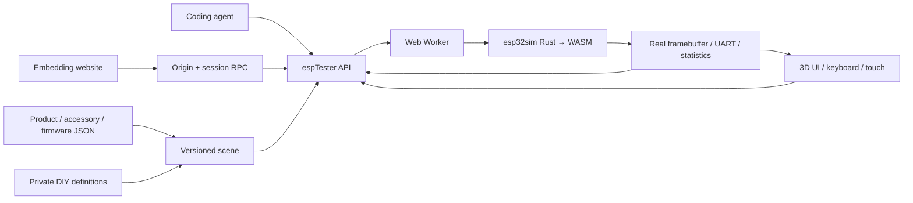

# ESP Online Tester platform

**Mission: an agent-configurable, human-playable and website-embeddable platform for product-level ESP32 devices.**

The product is the unit of configuration: chip, memory, display, controls, connectors and supported peripherals belong to a versioned catalog entry. Humans and agents operate the same running firmware. A 3D model presents its actual framebuffer and translates input into emulator events.

## Try it

[Workbench](https://zhuzhe1983.github.io/esp-online-tester/platform/) · [Standalone player](https://zhuzhe1983.github.io/esp-online-tester/platform/embed.html) · [Parent-page integration example](https://zhuzhe1983.github.io/esp-online-tester/platform/integration.html)

The default StopWatch diagnostic can be started immediately. A starts/pauses its clock, B resets it, and a touch is reported on the serial console. Add either GPS Unit revision and inject a position; the firmware echoes the generated NMEA and increments its received-line counter. This demonstrates a complete browser→UART→firmware→framebuffer path. It is not M5Stack's factory firmware or a satellite receiver model.

## Current scope

| Area | Implemented | Boundary |
| --- | --- | --- |
| StopWatch | ESP32-S3 execution, CO5300 display, power controllers, buttons, CST820 touch | Partial upstream board model; arbitrary product firmware is not guaranteed |
| PaperMono | Product metadata, interfaces, simple 3D preview, scene configuration | SSD1677/FT6336G board model not implemented; execution rejected |
| GPS U032 / U032-V11 | Separate revision records, parameter configuration, checksummed RMC/GGA into UART1 | Logical input; bypasses physical pins, power, baud timing and RF |
| Firmware | Manifest, remote merged BIN, local merged BIN, SHA-256 receipts | Remote server must allow CORS; separate app binaries need a complete manifest |
| Playback | 3D/2D display, rotate/zoom, buttons/touch, keyboard mapping, pause/resume/reset, frame capture | StopWatch uses manufacturer CAD with a sourced photo texture; other cases are illustrative; host input is not cycle-exact |
| Catalogs / DIY | Product/accessory/firmware JSON, schemas, semantic validation, private local definitions, import/export | Arbitrary new electrical models require Rust implementation; custom JSON does not execute scripts |
| Sharing / embedding | Portable URL fragment, independent player, fullscreen, origin/session-bound RPC | Local firmware bytes must be supplied separately; very large scenes should use JSON export |
| Product knowledge | Source-linked facts, datasheets, revisions and per-source UTC/hash records; static JSON index | Unknown hardware revision remains explicit; metadata does not imply runtime support |
| Recordings | Reset-based button/touch capture, share URL, manual replay/takeover, artifact hash and timing/frame receipts | 120 guest seconds / 500 events / 32 KiB; no camera, serial, GPS or hardware flashing; replay is not cycle-exact |
| Watchlist / flashing | Categorized official release sources, remote-only downloads, broken-link issue drafts, Web Serial in workbench and mini | User gesture and port selection required; secured devices and unverified watchlist artifacts rejected; no physical flash test yet |
| Agents | `window.espTester` v1, observable state, per-port logs, bounded waits and a skill | A queued input is not proof of firmware consumption |

## Architecture



This fork uses esp32sim's Rust CPU/peripheral implementation compiled directly to WebAssembly. QEMU is not part of this path. GitHub Actions builds the WASM and publishes static assets; no application server, account service or simulation backend is needed. Three.js is vendored locally under its MIT license. The inherited emulator and demos remain available at `run.html` and `emulator.html`.

The static host cannot bypass CORS or open arbitrary firmware TCP/UDP connections. Wi-Fi, BLE and accessory support depend on modeled behavior. Keep these limits in product capability metadata rather than claiming that chip instruction execution alone supports a device.

## Local development

```sh
rustup target add wasm32-unknown-unknown
tools/wasm-build.sh
tools/fetch-demo-assets.sh --no-linux
python3 -m http.server 8080 --directory web
```

Open `http://localhost:8080/platform/`. Use HTTP serving rather than `file://`; modules, workers and resource loading need a normal web origin. There is no frontend dependency installation or bundler.

The checked-in StopWatch binaries come from [the public diagnostic source](../../examples/platform-stopwatch/README.md). ROM files are fetched from Espressif by the existing asset script and checked against pinned hashes. CI builds the emulator, checks the platform and publishes `web/` to Pages. The root redirects to `platform/`; deployment works under the repository's Pages subpath.

## Firmware manifests

Upstream string file entries remain supported. A manifest can pin every referenced artifact:

```json
{
  "board": "stopwatch",
  "flash_mb": 16,
  "psram_mb": 8,
  "files": {
    "rom": "esp32s3_rev0_rom.elf",
    "bootloader": "bootloader.bin",
    "ptable": "partition-table.bin",
    "app": "application.bin"
  },
  "artifact_sha256": {
    "application.bin": "REPLACE_WITH_64_HEX_CHARACTERS"
  }
}
```

The hash string above is explanatory; use real hashes for a runnable manifest. The platform also accepts `{ "url": "application.bin", "sha256": "…" }` file entries. File URLs resolve relative to the manifest. Pin the manifest itself with `scene.firmware.sha256`; pin its files to prevent mutable paths from changing the executed image. Loading records the actual manifest and artifact hashes in `observe().firmware`. Mismatched chip, board, memory, incomplete merged images and oversized inputs are rejected.

## Agent and embedding contract

Use [the skill](../../skills/esp-online-tester/SKILL.md) and its [API reference](../../skills/esp-online-tester/references/api.md). Agents can configure, load, start, operate inputs, await new serial output, capture device pixels and generate share links. Prefer `waitFor({fromNow:true,port:'uart0',serialIncludes:…})` around each action to avoid passing a test with old output.

The player exposes a versioned `postMessage` handshake and a fixed method allowlist to its direct parent. Parent and child verify origin, window, session and request ID. The [integration example](../../web/platform/integration.html) is runnable source. Interactive embeds need JavaScript and a non-opaque origin; a sandbox without `allow-same-origin` cannot perform the RPC handshake. Avoid a sandbox unless its specific permissions have been tested for the intended host.

## Checks

```sh
node --test tools/platform-*-test.mjs
node tools/wasm-test.mjs hello c3-hello c6-hello panel demo-stopwatch
node tools/worker-pacing-test.mjs
node tools/worker-channel-test.mjs
node --test tools/touch-input-test.mjs tools/stopwatch-ui-test.mjs
node tools/check-evidence-privacy.mjs
```

The platform runtime test boots the actual worker/WASM with both Hello and StopWatch firmware. It checks pause/resume, stale callbacks, reset, display pixels, GPIO buttons, touch, complete GPS sentences, hash mismatches, local merged image loading and disposal. It does not replace browser rendering or physical hardware testing. Core changes also require the full Rust checks in `CONTRIBUTING.md`.

See [catalog contributions](contributing.md), the [onboarding skill](../../skills/esp-product-onboarding/SKILL.md), and [StopWatch model provenance and measured comparisons](stopwatch-model.md). Next hardware work is a PaperMono board implementation and comparison against the owner's actual StopWatch, PaperMono and GPS hardware. The original research is preserved under `research/` as historical planning; it is not the current API contract.

## Recording, remote updates and hardware flashing

Click **重启并录制**, operate the buttons or touchscreen, then **停止** and **分享场景**. The URL carries the scene and a semantic recording. The receiver explicitly starts replay; manual input takes over. Long links can be exported as a JSON bundle. Local firmware bytes cannot be recorded into a shareable URL; use a remotely readable, pinned source. Replay checks artifact hashes, preserves input intervals in guest time, and reports timing deviations and final framebuffer equality. Equal pixels alone are not proof that every intended behavior occurred.

The firmware watchlist is metadata-only: `node tools/check-firmware-watchlist.mjs --output target/firmware-watchlist-check.json` checks official releases and link status without mirroring binaries. The website distinguishes HTTP 404/410 from CORS/network errors and opens an issue draft for the user. Third-party artifacts are fetched into memory with `cache: no-store`. Existing upstream and first-party diagnostic fixtures retain their original purposes.

Both the workbench and mini player expose **刷到设备**. Use a Web Serial-capable browser on HTTPS or localhost. Cross-origin embeds need `allow="serial; fullscreen"` and permission from the parent Permissions Policy, or open the standalone player. The physical writer is deliberately absent from the recording/iframe RPC methods. It checks chip family, flash capacity, security state, image hashes and write offsets; only the affected sectors are written. Cancelling after writing starts can leave a partial image. Protocol tests use injected serial/loader doubles; no user hardware has been flashed by the development tests.
