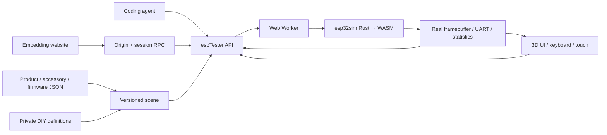

# ESP Online Tester platform

**Mission: an agent-configurable, human-playable and website-embeddable platform for product-level ESP32 devices.**

The product is the unit of configuration: chip, memory, display, controls, connectors and supported peripherals belong to a versioned catalog entry. Humans and agents operate the same running firmware. A 3D model presents its actual framebuffer and translates input into emulator events.

## Try it

[Workbench](https://zhuzhe1983.github.io/esp-online-tester/platform/) · [Standalone player](https://zhuzhe1983.github.io/esp-online-tester/platform/embed.html) · [Parent-page integration example](https://zhuzhe1983.github.io/esp-online-tester/platform/integration.html)

StopWatch defaults to M5Stack's official User Demo V0.5, downloaded directly from its CORS-enabled M5Burner CDN with a pinned SHA-256. Hold A+B together to open the menu, use A/B to choose a feature, then tap its icon. In Stopwatch, B starts/stops and A records a lap while running or resets while stopped. The original official binary runs through ROM and bootloader without app-direct mode or stubs; RTC, IMU, full audio and physical power behavior remain limited, and no hardware flash validation is claimed.

The public catalog contains all 83 ESP32 controller SKU/revision entries from the audited M5_Hardware Products inventory, ordered by each directory's latest commit, not product release date. Source-backed models retain measured deviations; Faces Kit has metadata only because no usable manufacturer 3D source was found. Products with a board model and complete target firmware allow an explicitly labeled trial even before compatibility verification; preview-only products still explain their missing runtime. StopWatch offers its official firmware only. GPS injection is covered by internal repository test firmware, not by the official demo. Hello and StopWatch diagnostics are test fixtures rather than public product entries. The StopWatch diagnostic manifest and binary files are explicitly excluded from the Pages artifact.

The workbench filters devices by manufacturer and sorts names naturally without changing the source catalog's inventory order. Small search buttons open cross-brand device or accessory search. Accessories can also be filtered by brand and physical connector; clearing the scene removes attached instances while preserving the local DIY library. Firmware is grouped by publisher, with identified official factory firmware first and selected on a fresh visit or device change. Explicit shared sources and user selections remain intact. Each SKU's factory-source investigation is recorded in [the audit](research/factory-firmware-audit-2026-10-27.json); an unknown or unpublished factory image is not replaced by a supposed equivalent.

## Current scope

| Area | Implemented | Boundary |
| --- | --- | --- |
| StopWatch | ESP32-S3 execution, CO5300 display, power controllers, buttons, CST820 touch | Partial upstream board model; arbitrary product firmware is not guaranteed |
| PaperMono / Lite | Official 1.2.0 boots to real 480×800 EPD framebuffer; A/B brightness, FT6336G touch, FAT32 card mounting/directory reads and RGB output verified; manufacturer CAD | Partial: official app currently identifies Lite; NFC/LoRa, RTC timekeeping, IMU initialization, audio and deep sleep remain unsupported or unverified |
| Cardputer-Adv | Official v0.3 ROM boot, ST7789 display and TCA8418 keyboard; 56 individual CAD keys, host mapping and menu navigation | Partial: menu entries do not establish audio, storage, radio or other app compatibility; no physical hardware comparison |
| Cardputer / v1.1 | Official v1.1 ROM boot, ST7789 display and 74HC138 GPIO keyboard; Enter and launcher navigation | Separate original board implementation; audio, SD, radios/HID, IR applications and power remain unverified |
| GPS U032 / U032-V11 | Separate revision records, parameter configuration, checksummed RMC/GGA into UART1 | Logical input; bypasses physical pins, power, baud timing and RF |
| Button U027 / Angle U005 / RGB U003 | Manufacturer-derived 3D assets, sourced dimensions, connector records and separate knowledge entries | Visual configuration only; GPIO, ADC and SK6812 behavior is not implemented |
| Firmware | Manifest, remote/local merged BIN, local flasher_args.json build segments, SHA-256 receipts | Remote server must allow CORS; local app binaries need their build layout and companion files |
| Playback | 3D/2D display, rotate/zoom, buttons/touch, keyboard mapping, pause/resume/reset, frame capture | Source-backed models retain per-product partial status and verification reports; host input is not cycle-exact |
| Catalogs / DIY | Product/accessory/firmware JSON, schemas, semantic validation, private local definitions, import/export | Arbitrary new electrical models require Rust implementation; custom JSON does not execute scripts |
| Sharing / embedding | Portable URL fragment, independent player, fullscreen, origin/session-bound RPC; incompatible old recordings are omitted with a notice rather than blocking UI sharing | Local firmware bytes must be supplied separately; very large scenes should use JSON export |
| Product knowledge | Source-linked facts, datasheets, revisions and per-source UTC/hash records; static JSON index | Unknown hardware revision remains explicit; metadata does not imply runtime support |
| Recordings | Reset-based button/matrix-key/touch capture, share URL, manual replay/takeover, artifact hash and timing/frame receipts | Pristine device storage required; 120 guest seconds / 500 events / 32 KiB; no camera, serial, GPS or hardware flashing; replay is not cycle-exact |
| Watchlist / flashing | Categorized official release sources, remote-only downloads, broken-link issue drafts, Web Serial in workbench and mini | User gesture and port selection required; secured devices and unverified watchlist artifacts rejected; no physical flash test yet |
| Agents | `window.espTester` v1, observable state, per-port logs, bounded waits and a skill | A queued input is not proof of firmware consumption |

## Architecture



This fork uses esp32sim's Rust CPU/peripheral implementation compiled directly to WebAssembly. QEMU is not part of this path. GitHub Actions builds the WASM and publishes static assets; no application server, account service or simulation backend is needed. Three.js is vendored locally under its MIT license. The inherited emulator and demos remain available at `run.html` and `emulator.html`.

The static host cannot bypass CORS or open arbitrary firmware TCP/UDP connections. Wi-Fi, BLE and accessory support depend on modeled behavior. Keep these limits in product capability metadata rather than claiming that chip instruction execution alone supports a device.

## Local development

```sh
rustup target add wasm32-unknown-unknown
tools/wasm-build.sh
tools/fetch-demo-assets.sh --no-linux
python3 -m http.server 8080 --directory web
```

Open `http://localhost:8080/platform/`. Use HTTP serving rather than `file://`; modules, workers and resource loading need a normal web origin. There is no frontend dependency installation or bundler.

The repository-only StopWatch test binaries come from [the diagnostic source](../../examples/platform-stopwatch/README.md). ROM files are fetched from Espressif by the existing asset script and checked against pinned hashes. CI builds the emulator, checks the platform, then stages a public copy of `web/` with `tools/stage-platform-pages.mjs`, excluding the internal StopWatch diagnostic manifest and binaries before publishing to Pages. The root redirects to `platform/`; deployment works under the repository's Pages subpath.

## Firmware manifests

Upstream string file entries remain supported. A manifest can pin every referenced artifact:

```json
{
  "board": "stopwatch",
  "flash_mb": 16,
  "psram_mb": 8,
  "files": {
    "rom": "esp32s3_rev0_rom.elf",
    "bootloader": "bootloader.bin",
    "ptable": "partition-table.bin",
    "app": "application.bin"
  },
  "artifact_sha256": {
    "application.bin": "REPLACE_WITH_64_HEX_CHARACTERS"
  }
}
```

The hash string above is explanatory; use real hashes for a runnable manifest. The platform also accepts `{ "url": "application.bin", "sha256": "…" }` file entries. File URLs resolve relative to the manifest. Pin the manifest itself with `scene.firmware.sha256`; pin its files to prevent mutable paths from changing the executed image. Loading records the actual manifest and artifact hashes in `observe().firmware`. Mismatched chip, board, memory, incomplete merged images and oversized inputs are rejected.

## Agent and embedding contract

Use [the skill](../../skills/esp-online-tester/SKILL.md) and its [API reference](../../skills/esp-online-tester/references/api.md). Agents can configure, load, start, operate inputs, await new serial output, capture device pixels and generate share links. Prefer `waitFor({fromNow:true,port:'uart0',serialIncludes:…})` around each action to avoid passing a test with old output.

The player exposes a versioned `postMessage` handshake and a fixed method allowlist to its direct parent. Parent and child verify origin, window, session and request ID. The [integration example](../../web/platform/integration.html) is runnable source. Interactive embeds need JavaScript and a non-opaque origin; a sandbox without `allow-same-origin` cannot perform the RPC handshake. Avoid a sandbox unless its specific permissions have been tested for the intended host.

## Checks

```sh
node --test tools/platform-*-test.mjs
node tools/wasm-test.mjs hello c3-hello c6-hello panel demo-stopwatch
node tools/worker-pacing-test.mjs
node tools/worker-channel-test.mjs
node --test tools/touch-input-test.mjs tools/stopwatch-ui-test.mjs
node tools/check-evidence-privacy.mjs
```

The platform runtime test boots the actual worker/WASM with both Hello and StopWatch firmware. It checks pause/resume, stale callbacks, reset, display pixels, GPIO buttons, touch, complete GPS sentences, hash mismatches, local merged image loading and disposal. It does not replace browser rendering or physical hardware testing. Core changes also require the full Rust checks in `CONTRIBUTING.md`.

See [catalog contributions](contributing.md), the [onboarding skill](../../skills/esp-product-onboarding/SKILL.md), and [StopWatch model provenance and measured comparisons](stopwatch-model.md). See [PaperMono runtime evidence](papermono-runtime.md) and [Cardputer-Adv runtime evidence](cardputer-adv-runtime.md) for their verified subsets. Other imported products still need their own board/peripheral adaptation and comparison with physical hardware. The original research is preserved under `research/` as historical planning; it is not the current API contract.

The **外壳** menu changes shell color, opacity and eight material finishes without resetting firmware. Black/purple translucent and gold presets work in the standalone player and share links. The blank `pcb-main` model marked `UNKNOWN` is an estimated placeholder; manufacturer PCB geometry has not been located in the audited sources. See the [exploded-view plan and PCB source audit](exploded-view-plan.md) and [M5_Hardware inventory](research/m5-hardware-inventory-2026-10-26.md). Exploded animation is planned, not yet exposed by the viewer.

## Virtual TF card and RGB output

PaperMono/Lite load with a browser-generated 64 MiB FAT32 card. Both the workbench and mini player offer import, export and clear controls. Imports accept complete 1–128 MiB raw disk images in 512 KiB increments; import/clear saves current Flash and SD, rebuilds the machine and leaves it ready for an explicit start. Export returns the complete disk image. Clearing SD does not clear Flash or downloaded firmware.

SD data is isolated by product ID, board and the original full-Flash SHA-256. IndexedDB stores an imported base separately from changed 4 KiB pages; the same device/firmware restores them after reset or reload. Other tabs' newer saves/clears invalidate stale writers. The scan interval is 1.5 seconds and `crashSafe:false`: shutdown flushes are best effort, and memory fallback cannot retain data across reload. Private cards are excluded from share URLs and portable recordings.

Agents use `attachSdCard`, `clearSdCard`, `exportSdCard` and `flushSdCard`; `observe().sdCard` exposes status and `capabilities().sdCard` exposes limits. RGB is reported by `observe().leds` and `leds` events, derived from the guest's PM1/IOE outputs. See [the API contract](../../skills/esp-online-tester/references/api.md#virtual-tfsd-cards-and-rgb-output) and [PaperMono evidence and limits](papermono-runtime.md).

## Recording, remote updates and hardware flashing

Click **重启并录制**, operate the buttons or touchscreen, then **停止** and **分享场景**. The URL carries the scene and a semantic recording. The receiver explicitly starts replay; manual input takes over. Long links can be exported as a JSON bundle. Local firmware bytes cannot be recorded into a shareable URL; use a remotely readable, pinned source. Replay checks artifact hashes, preserves input intervals in guest time, and reports timing deviations and final framebuffer equality. Equal pixels alone are not proof that every intended behavior occurred.

The firmware watchlist is metadata-only: `tools/sync-firmware-release-metadata.mjs` updates the static release snapshot using an authenticated daily Action. Browser checks read that snapshot and probe asset links without calling GitHub’s anonymous release API. `node tools/check-firmware-watchlist.mjs --output target/firmware-watchlist-check.json` audits the snapshot and link status without mirroring binaries. The website distinguishes HTTP 404/410 from CORS/network errors and opens an issue draft for the user. Third-party artifacts are fetched directly from the publisher with `cache: no-store`; hash-pinned bytes may be cached in the user's IndexedDB (64 MiB LRU) and are rehashed on reuse. Clear the browser cache with the firmware panel action or `clearFirmwareCache()`. The server and Git repository never mirror these binaries. Existing upstream and first-party diagnostic fixtures retain their original purposes.

Official firmware published through M5Burner can use its metadata adapter with a fixed firmware ID. The sync keeps only published version/date/CDN fields, excludes unrelated author details, and sends no GitHub token to M5Burner. A new release is a discovery result; it does not replace the pinned default or establish runtime compatibility. PaperMono's official 1.2.0 entry uses this source.

Before submitting catalog changes, install `tools/requirements-catalog.txt` in a development environment and run `python tools/validate-platform-catalog.py`. This resolves schemas locally and checks each catalog's intended entry type. Follow it with `node tools/platform-knowledge-test.mjs` for source and knowledge references. Pages runs both validations before deployment.

Both the workbench and mini player expose **刷到设备**. Use a Web Serial-capable browser on HTTPS or localhost. Cross-origin embeds need `allow="serial; fullscreen"` and permission from the parent Permissions Policy, or open the standalone player. The physical writer is deliberately absent from the recording/iframe RPC methods. It checks chip family, flash capacity, security state, image hashes and write offsets; only the affected sectors are written. Cancelling after writing starts can leave a partial image. Protocol tests use injected serial/loader doubles; no user hardware has been flashed by the development tests.

## Local build files and execution availability

Select a complete merged BIN directly, or select an app BIN followed by `flasher_args.json` and every file it references. Selecting the whole build directory preserves relative paths. The loader validates offsets, chip, flash size, bootloader and application partition before initializing the emulator. Files stay in the browser; no private firmware is uploaded. See [local firmware layouts](local-firmware.md).

**下载并运行** loads into the emulator and starts it, without saving a file into the computer's Downloads folder. For a preview-only product such as NanoH2, the action remains disabled with a visible explanation, even when a remote release has been found. The mini player follows the same execution boundary.
