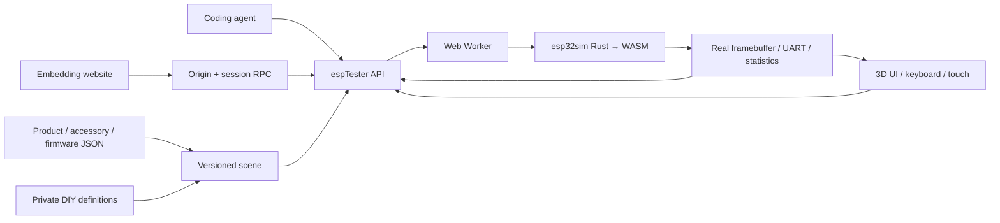

# ESP Online Tester platform

**Mission: an agent-configurable, human-playable and website-embeddable platform for product-level ESP32 devices.**

The product is the unit of configuration: chip, memory, display, controls, connectors and supported peripherals belong to a versioned catalog entry. Humans and agents operate the same running firmware. A 3D model presents its actual framebuffer and translates input into emulator events.

## Try it

[Workbench](https://zhuzhe1983.github.io/esp-online-tester/platform/) · [Standalone player](https://zhuzhe1983.github.io/esp-online-tester/platform/embed.html) · [Parent-page integration example](https://zhuzhe1983.github.io/esp-online-tester/platform/integration.html)

StopWatch defaults to M5Stack's official User Demo V0.5, downloaded directly from its CORS-enabled M5Burner CDN with a pinned SHA-256. Hold A+B together to open the menu, use A/B to choose a feature, then tap its icon. In Stopwatch, B starts/stops and A records a lap while running or resets while stopped. The original official binary runs through ROM and bootloader without app-direct mode or stubs; RTC, IMU, full audio and physical power behavior remain limited, and no hardware flash validation is claimed.

The public catalog contains all 83 ESP32 controller SKU/revision entries from the audited M5_Hardware Products inventory, ordered by each directory's latest commit, not product release date. Source-backed models retain measured deviations; Faces Kit has metadata only because no usable manufacturer 3D source was found. Products with a board model and complete target firmware allow an explicitly labeled trial even before compatibility verification; preview-only products still explain their missing runtime. StopWatch offers its official firmware only. GPS injection is covered by internal repository test firmware, not by the official demo. Hello and StopWatch diagnostics are test fixtures rather than public product entries. The StopWatch diagnostic manifest and binary files are explicitly excluded from the Pages artifact.

The workbench filters devices by manufacturer and sorts names naturally without changing the source catalog's inventory order. Small search buttons open cross-brand device or accessory search. Accessories can also be filtered by brand and physical connector; clearing the scene removes attached instances while preserving the local DIY library. Firmware is grouped by publisher, with identified official factory firmware first and selected on a fresh visit or device change. Explicit shared sources and user selections remain intact. Each SKU's factory-source investigation is recorded in [the audit](research/factory-firmware-audit-2026-10-27.json); an unknown or unpublished factory image is not replaced by a supposed equivalent.

The LILYGO inventory follows Spark’s stable series IDs and product IDs: 127 ESP32 product listings across 21 groups, with T-Deck, Plus, Pro and their Meshtastic-preloaded editions kept distinct. The workbench offers family filtering and grouped model choices. The initial six exact hardware variants remain the adaptation priority: original TTGO T-Display, T-Display-S3 (non-touch), original T-Deck, T-Embed CC1101, T-Beam V1.2 and T-Watch-S3. New listings retain unknown hardware fields and unavailable runtimes until individually investigated. Five exact variants now have partial board runtimes: original T-Display, non-touch T-Display-S3, original T-Deck, T-Embed CC1101 and T-Beam V1.2. Official firmware/input evidence is recorded separately; T-Display-S3 factory remains blocked despite a working official TFT demo. T-Watch S3 and the additionally requested T5 4.7-inch remain queued while work is paused. Manufacturer CAD is an independent visual asset and does not establish runtime compatibility. Factory images stay remote and the existing shared firmware watchlist includes the applicable community projects. See [LILYGO integration and limits](lilygo-onboarding.md).

## Current scope

Remote HTTPS firmware loads retain up to 40 recent address records in this browser's localStorage, grouped by device. The history dropdown shows name, version and last-use age; selecting one restores the source type and optional SHA without starting the device. Names/versions come from a hash-matched catalog entry, an ESP-IDF app descriptor, or manifest metadata; unknown versions stay unknown. Attempts with network errors remain reusable. History is separate from firmware-byte caching, is never included in scene/share exports, and can be cleared per device. If browser storage is unavailable it falls back to this page's memory.

For M5Stack devices, **远程地址 → burner.m5stack.com** replaces the manual URL/hash fields with device-scoped firmware search and public version selection. The explicitly used metadata service is `https://burner.m5stack.com/api/v1`; firmware downloads use its fixed firmware/version endpoint, which redirects to the publisher's CDN. Requests are anonymous (`credentials: omit`). Exact documentation URLs or exact normalized device names select the category; revisions without an exact category remain unmatched rather than inheriting another device's firmware. Search is metadata-only, paginated in batches of 50, and does not download or execute firmware. All returned binaries still pass the normal chip/layout checks; unverified firmware asks for confirmation and unavailable boards have no run button. The [dated API/CORS audit](research/m5burner-v1-cors-2026-10-27.md) documents the public endpoints.

For LILYGO devices, **远程地址 → LILYGO Spark** occupies the same source selector. It reads the official Spark repository's browser-readable manifest, exposes its catalog date, and matches the catalog’s declared Spark product ID. The six audited hardware mappings also filter exact device/file paths because upstream product tags include sibling-board mismatches. New product mappings expose reference information only until the binary/hardware relationship is reviewed. Search only reads metadata. Audited BIN and single-BIN ZIP entries use the loading and history path. ZIP payloads are extracted and checked against the BIN hash before boot layout detection; a ZIP/BIN import fallback handles hosts without browser CORS. Deleted T-Embed example paths are recovered only through exact-hash, immutable official URLs. See [Spark loading and sharing](lilygo-spark-loading.md). The configured OSS manifest currently lacks browser CORS, so this integration uses the official repository copy and does not proxy firmware or claim it is as fresh as the desktop service.

After a Burner selection is downloaded and execution starts, its fixed-version URL, publisher name/version, actual content SHA-256 and last-use time enter the same 40-entry history. Restoring a record neither searches nor starts automatically; the pinned hash allows reusing verified browser-cache bytes, including after reload. The first download's computed digest is retained in the browser cache, but an unpinned URL still fetches afresh. These observed hashes detect later changes; they are not publisher signatures. No firmware is mirrored on the site or saved as a filesystem download. A manufacturer-scoped device counter displays adapted / total, with adaptation meaning an available board model including partial support, not full firmware compatibility. The 2026-10-28 integrated catalog including K147 is M5Stack **28/84** and Metalio **1/2**; the [16-controller integration receipt](controller-integration-2026-10-28.md) and [per-product queue](device-runtime-queue.md) link individual firmware results and limits.

| Area | Implemented | Boundary |
| --- | --- | --- |
| StopWatch | ESP32-S3 execution, CO5300 display, power controllers, buttons, CST820 touch | Partial upstream board model; arbitrary product firmware is not guaranteed |
| PaperMono / Lite | Official 1.2.0 boots to real 480×800 EPD framebuffer; A/B brightness, FT6336G touch, FAT32 card mounting/directory reads and RGB output verified; manufacturer CAD | Partial: full PaperMono additionally has ST25R3916/SX1262 digital subsets and identifies Pro; Lite omits those devices. No real RF/NFC cards, RTC timekeeping, complete IMU, audio or deep sleep; see [scope](papermono-runtime.md) |
| Cardputer-Adv | Official v0.3 ROM boot, ST7789 display and TCA8418 keyboard; 56 individual CAD keys, host mapping and menu navigation | Partial: menu entries do not establish audio, storage, radio or other app compatibility; no physical hardware comparison |
| Cardputer / v1.1 | Official v1.1 ROM boot, ST7789 display and 74HC138 GPIO keyboard; Enter and launcher navigation | Separate original board implementation; audio, SD, radios/HID, IR applications and power remain unverified |
| Dial K130 | GC9A01 240×240 display, FT3267 single contact, GPIO42 front press and A41/B40 quadrature encoder; real-WASM fixture and recorder | Original K130 only; RTC/RFID, audio, PWM backlight and power latch absent; factory EXE/source remains a reference |
| AtomS3R C126 | ST7735 128×128 SPI display, LP5562 direct white backlight, GPIO41 display button, BMI270 polled I2C registers, 8 MiB Octal PSRAM | Partial: current ST7735 batch only; BMM150 AUX, RGB/IR, IMU FIFO/timing and physical mounting unimplemented or unverified |
| AtomS3 C123 | GC9107 128×128 SPI display, active-low GPIO41 display-cover button, MPU6886 polled I2C registers; real-WASM internal fixture checks pixels and guest input readings | Partial: GC9107 variant only; PWM brightness, IR, IMU FIFO/interrupt/ODR and physical sensor orientation remain unimplemented or unverified |
| AtomS3R Chatbot K147 | GC9107 batch, LP5562 white backlight, GPIO41 press; official UIFlow2 ROM boot and page change | Partial: audio base absent; official Xiaozhi reports disconnected base. No cloud/network/IR. [Evidence](atoms3r-chatbot-runtime.md) |
| AtomS3-Lite C124 | GPIO41 front key and one GPIO35 WS2812C via guest RMT; official UIFlow2 blue status light, extracted factory ROM boot/button count | Partial: no display; software GPIO timing, IR, analog power/reset and external Grove routing unimplemented. Factory EXE remains reference-only. [Evidence](atoms3-lite-runtime.md) |
| GPS U032 / U032-V11 | Separate revision records, parameter configuration, checksummed RMC/GGA into UART1 | Logical input; bypasses physical pins, power, baud timing and RF |
| Unit Button U027 V1.0 | 3D/panel/API press and detach events drive StopWatch Port A GPIO11; Grove 5V gating and guest pull behavior verified in real WASM | Partial: only this SKU/host/port; steady digital levels, no RC/bounce/analog contention or hardware comparison. [Evidence](unit-button-runtime.md) |
| Angle U005 / RGB U003 / Hub U006 | StopWatch Port A physical ADC2 / RMT output and one passive parallel hub layer | Host, signal, supply and topology restrictions remain; see [Angle](unit-angle-runtime.md), [RGB](unit-rgb-runtime.md), [Hub](unit-hub-runtime.md) |
| Firmware | Manifest, remote merged/app-only BIN, local merged BIN or flasher_args.json build segments, SHA-256 receipts | Remote server must allow CORS; local app binaries need their build layout and companion files |
| Playback | 3D/2D display, rotate/zoom, buttons/touch, keyboard mapping, pause/resume/reset, frame capture | Source-backed models retain per-product partial status and verification reports; host input is not cycle-exact |
| Catalogs / DIY | Product/accessory/firmware JSON, schemas, semantic validation, private local definitions, import/export | Arbitrary new electrical models require Rust implementation; custom JSON does not execute scripts |
| Sharing / embedding | Portable URL fragment, independent player, fullscreen, origin/session-bound RPC; incompatible old recordings are omitted with a notice rather than blocking UI sharing | Local firmware bytes must be supplied separately; very large scenes should use JSON export |
| Product knowledge | Source-linked facts, datasheets, revisions and per-source UTC/hash records; static JSON index | Unknown hardware revision remains explicit; metadata does not imply runtime support |
| Recordings | Reset-based button/matrix-key/encoder/touch and supported accessory button/connection capture, share URL, automatic replay/takeover, artifact hash and timing/frame receipts | Pristine device storage required; 120 guest seconds / 500 events / 32 KiB; no camera, serial, GPS or hardware flashing; replay is not cycle-exact |
| Watchlist / flashing | Categorized official release sources, remote-only downloads, broken-link issue drafts, Web Serial in workbench and mini | User gesture and port selection required; secured devices and unverified watchlist artifacts rejected; no physical flash test yet |
| Agents | `window.espTester` v1, observable state, per-port logs, bounded waits and a skill | A queued input is not proof of firmware consumption |

## Architecture



This fork uses esp32sim's Rust CPU/peripheral implementation compiled directly to WebAssembly. QEMU is not part of this path. GitHub Actions builds the WASM and publishes static assets; no application server, account service or simulation backend is needed. Three.js is vendored locally under its MIT license. The inherited emulator and demos remain available at `run.html` and `emulator.html`.

The static host cannot bypass CORS or open arbitrary firmware TCP/UDP connections. Wi-Fi, BLE and accessory support depend on modeled behavior. Keep these limits in product capability metadata rather than claiming that chip instruction execution alone supports a device.

## Local development

```sh
rustup target add wasm32-unknown-unknown
tools/wasm-build.sh
tools/fetch-demo-assets.sh --no-linux
python3 -m http.server 8080 --directory web
```

Open `http://localhost:8080/platform/`. Use HTTP serving rather than `file://`; modules, workers and resource loading need a normal web origin. There is no frontend dependency installation or bundler.

The repository-only StopWatch test binaries come from [the diagnostic source](../../examples/platform-stopwatch/README.md). ROM files are fetched from Espressif by the existing asset script and checked against pinned hashes. CI builds the emulator, checks the platform, then stages a public copy of `web/` with `tools/stage-platform-pages.mjs`, excluding the internal StopWatch diagnostic manifest and binaries before publishing to Pages. The root redirects to `platform/`; deployment works under the repository's Pages subpath.

## Firmware manifests

Upstream string file entries remain supported. A manifest can pin every referenced artifact:

```json
{
  "board": "stopwatch",
  "flash_mb": 16,
  "psram_mb": 8,
  "files": {
    "rom": "esp32s3_rev0_rom.elf",
    "bootloader": "bootloader.bin",
    "ptable": "partition-table.bin",
    "app": "application.bin"
  },
  "artifact_sha256": {
    "application.bin": "REPLACE_WITH_64_HEX_CHARACTERS"
  }
}
```

The hash string above is explanatory; use real hashes for a runnable manifest. The platform also accepts `{ "url": "application.bin", "sha256": "…" }` file entries. File URLs resolve relative to the manifest. Pin the manifest itself with `scene.firmware.sha256`; pin its files to prevent mutable paths from changing the executed image. Loading records the actual manifest and artifact hashes in `observe().firmware`. Mismatched chip, board, memory, incomplete merged images and oversized inputs are rejected. Remote raw BINs also accept a structurally validated standalone application using experimental application-direct startup; this does not supply a bootloader or partition layout. The source records `bootMode` and SHA-256, including in browser history and portable scenes. See [remote BIN startup](remote-firmware-boot.md) for the detection checks and limits.

## Agent and embedding contract

Use [the skill](../../skills/esp-online-tester/SKILL.md) and its [API reference](../../skills/esp-online-tester/references/api.md). Agents can configure, load, start, operate inputs, await new serial output, capture device pixels and generate share links. Prefer `waitFor({fromNow:true,port:'uart0',serialIncludes:…})` around each action to avoid passing a test with old output.

The player exposes a versioned `postMessage` handshake and a fixed method allowlist to its direct parent. Parent and child verify origin, window, session and request ID. The [integration example](../../web/platform/integration.html) is runnable source. Interactive embeds need JavaScript and a non-opaque origin; a sandbox without `allow-same-origin` cannot perform the RPC handshake. Avoid a sandbox unless its specific permissions have been tested for the intended host.

## Checks

```sh
node --test tools/platform-*-test.mjs
node tools/wasm-test.mjs hello c3-hello c6-hello panel demo-stopwatch
node tools/worker-pacing-test.mjs
node tools/worker-channel-test.mjs
node --test tools/touch-input-test.mjs tools/stopwatch-ui-test.mjs
node tools/check-evidence-privacy.mjs
```

The platform runtime test boots the actual worker/WASM with both Hello and StopWatch firmware. It checks pause/resume, stale callbacks, reset, display pixels, GPIO buttons, touch, complete GPS sentences, hash mismatches, local merged image loading and disposal. It does not replace browser rendering or physical hardware testing. Core changes also require the full Rust checks in `CONTRIBUTING.md`.

See [catalog contributions](contributing.md), the [onboarding skill](../../skills/esp-product-onboarding/SKILL.md), and [StopWatch model provenance and measured comparisons](stopwatch-model.md). See [PaperMono runtime evidence](papermono-runtime.md), [Cardputer-Adv runtime evidence](cardputer-adv-runtime.md) [AtomS3 runtime evidence](atoms3-runtime.md) and [AtomS3R runtime evidence](atoms3r-runtime.md) for their verified subsets. The [device adaptation queue](device-runtime-queue.md) tracks remaining product-specific work. Other imported products still need their own board/peripheral adaptation and comparison with physical hardware. The original research is preserved under `research/` as historical planning; it is not the current API contract.

The **外壳** menu changes shell color, opacity and eight material finishes without resetting firmware. Black/purple translucent and gold presets work in the standalone player and share links. The blank `pcb-main` model marked `UNKNOWN` is an estimated placeholder; manufacturer PCB geometry has not been located in the audited sources. See the [exploded-view plan and PCB source audit](exploded-view-plan.md) and [M5_Hardware inventory](research/m5-hardware-inventory-2026-10-26.md). Exploded animation is planned, not yet exposed by the viewer.

## Virtual TF card and RGB output

PaperMono/Lite and PaperS3 load with a browser-generated 64 MiB FAT32 card. Both the workbench and mini player offer import, export and clear controls. Imports accept complete 1–128 MiB raw disk images in 512 KiB increments; import/clear saves current Flash and SD, rebuilds the machine and leaves it ready for an explicit start. Export returns the complete disk image. Clearing SD does not clear Flash or downloaded firmware.

SD data is isolated by product ID, board and the original full-Flash SHA-256. IndexedDB stores an imported base separately from changed 4 KiB pages; the same device/firmware restores them after reset or reload. Other tabs' newer saves/clears invalidate stale writers. The scan interval is 1.5 seconds and `crashSafe:false`: shutdown flushes are best effort, and memory fallback cannot retain data across reload. Private cards are excluded from share URLs and portable recordings.

Agents use `attachSdCard`, `clearSdCard`, `exportSdCard` and `flushSdCard`; `observe().sdCard` exposes status and `capabilities().sdCard` exposes limits. RGB is reported by `observe().leds` and `leds` events, derived from the guest's PM1/IOE outputs. See [the API contract](../../skills/esp-online-tester/references/api.md#virtual-tfsd-cards-and-rgb-output) and [PaperMono evidence and limits](papermono-runtime.md).

## Recording, remote updates and hardware flashing

Click **重启并录制**, operate the buttons or touchscreen, then **停止** and **分享场景**. The URL carries the scene and a semantic recording. The receiver’s valid shared scene starts automatically and replays its recording; manual input takes over. Unverified catalog firmware asks for confirmation once before downloading. Use `autostart=0` in the URL fragment for a preview/edit-only link, or `autoplay=0` to start firmware without replay. The plain workbench remains idle, invalid scenes/recordings do not start fallback firmware, and missing boards show “尚未完成适配”. Automatic replay never clears saved Flash/SD data; the pristine-storage checks still apply. Long links can be exported as a JSON bundle. Local firmware bytes cannot be recorded into a shareable URL; use a remotely readable, pinned source. Replay checks artifact hashes, preserves input intervals in guest time, and reports timing deviations and final framebuffer equality. Equal pixels alone are not proof that every intended behavior occurred.

The firmware watchlist is metadata-only: `node tools/sync-firmware-catalog.mjs` checks release history and updates each explicitly matched device firmware version, remote URL and publisher SHA-256. Run it before local publication (`--dry-run` previews changes; `--snapshot-only` uses the saved snapshot). Pages runs the same check before building its exact resulting commit, and the manual **Check firmware update** Action checks and publishes by default. Daily Pages also refreshes the catalog. `catalogTargets` match device, release channel and artifact format; devices without a new matching asset retain their existing version. Missing digests, ambiguous matches and source failures retain pinned entries with reasons in `web/platform/catalog/firmware-catalog-sync-report.json`. New artifacts become unverified trials and old validation is archived; same-version artifacts retain their current validated sources. This process neither downloads nor executes firmware bodies. Browser checks read that snapshot and probe asset links without calling GitHub’s anonymous release API. `node tools/check-firmware-watchlist.mjs --output target/firmware-watchlist-check.json` audits the snapshot and link status without mirroring binaries. The website distinguishes HTTP 404/410 from CORS/network errors and opens an issue draft for the user. Third-party artifacts are fetched directly from the publisher with `cache: no-store`; hash-pinned bytes may be cached in the user's IndexedDB (64 MiB LRU) and are rehashed on reuse. Clear the browser cache with the firmware panel action or `clearFirmwareCache()`. The server and Git repository never mirror these binaries. Existing upstream and first-party diagnostic fixtures retain their original purposes.

Official firmware published through M5Burner can use its metadata adapter with a fixed firmware ID. The sync keeps only published version/date/CDN fields, excludes unrelated author details, and sends no GitHub token to M5Burner. A new release with an explicit device mapping and publisher digest may update the pinned catalog entry, including a factory default; it does not establish runtime compatibility. Without those facts it remains a discovery result. PaperMono's official 1.2.0 entry uses this source.

Before submitting catalog changes, install `tools/requirements-catalog.txt` in a development environment and run `python tools/validate-platform-catalog.py`. This resolves schemas locally and checks each catalog's intended entry type. Follow it with `node tools/platform-knowledge-test.mjs` for source and knowledge references. Pages runs both validations before deployment.

Both the workbench and mini player expose **刷到设备**. Use a Web Serial-capable browser on HTTPS or localhost. Cross-origin embeds need `allow="serial; fullscreen"` and permission from the parent Permissions Policy, or open the standalone player. The physical writer is deliberately absent from the recording/iframe RPC methods. It checks chip family, flash capacity, security state, image hashes and write offsets; only the affected sectors are written. Cancelling after writing starts can leave a partial image. Protocol tests use injected serial/loader doubles; no user hardware has been flashed by the development tests.

## Local build files and execution availability

Select a complete merged BIN directly, or select an app BIN followed by `flasher_args.json` and every file it references. Selecting the whole build directory preserves relative paths. The loader validates offsets, chip, flash size, bootloader and application partition before initializing the emulator. Firmware files and JSON manifests accept up to 256 MiB each; firmware bundles also have a 256 MiB total limit. The selected product’s Flash capacity and image layout still apply. Files stay in the browser; no private firmware is uploaded. See [local firmware layouts](local-firmware.md).

**下载并运行** loads into the emulator and starts it, without saving a file into the computer's Downloads folder. For a preview-only product such as NanoH2, run buttons are hidden and a red **尚未完成适配** label is shown, even when a remote release has been found. If the board model exists, unverified catalog firmware asks for confirmation only when Run is clicked; Cancel makes no firmware request. Verified firmware runs directly. **报告问题** opens an issue draft with device/firmware identity, current error and bounded recent logs after common credential/path/device-identifier redaction; the user describes and submits the issue. The mini player follows the same boundary. The agent API remains noninteractive.

Unit RGB U003 的真实 RMT 灯光、供电和拔插支持见 [U003 runtime](unit-rgb-runtime.md)。目前仅核验 StopWatch Port A 黄线 G10，软件 GPIO、串级及实体灯孔链序尚未验证。

Unit Angle U005 已支持 StopWatch Port A 的标称模拟电压输入与真实 ADC2 转换；官方图纸冲突、机械角度未校准等边界见 [Unit Angle 运行说明](unit-angle-runtime.md)。

[Unit Hub U006](unit-hub-runtime.md) adds one passive parallel layer between StopWatch Port A and the supported U027/U003/U005 units. Signal contention is rejected; output socket visual pin1 is still unknown and its cables remain hidden.

[Unit ENV-IV U001-D](unit-env4-runtime.md) exposes SHT40/BMP280 over actual StopWatch G10/G11 hardware I²C, with editable ambient values, supply gating, disconnect and recording. It uses both signal lines; software I²C and heater are not implemented. Related ENV-III CAD reuse is explicitly identified and checked against ENV-IV references.

[Unit DLight U136](unit-dlight-runtime.md) adds the BH1750 command, gain and conversion model on real StopWatch G10/G11 I²C. Editable illuminance, supply/disconnect/reset, recording and mini use the common runtime. One U006 may carry DLight and ENV-IV at distinct addresses; duplicate addresses and GPIO contention remain rejected.

[Unit PIR U004](unit-pir-runtime.md) adds the AS312 nominal 2-second retriggerable profile on real StopWatch G11, with M5PM1 power, unplug, guest output, recording and mini. Warm-up, optical and lock-window behavior are not calibrated; the model retains an UNKNOWN PCB.

## Browser network and audio

The workbench accesses S3 SoftAP pages inside the browser. For external sockets, users [deploy their own local or cloud helper](network-setup.md) and enter its address in the network panel; the site supplies no default public relay. The [local helper](network-helper.md) also supplies LAN access and HTTP/TCP/UDP port mappings. The [cloud helper](public-network-relay.md) provides public Internet egress only. Automatic provisioning is enabled by default and waits for an external transport. See [implemented scope](wifi-platform-plan.md).

The 3D stage has microphone and speaker controls. Agents use `audioConfigure`, `pushAudio`, and `readAudio` for bounded PCM streaming without a sound device. See [audio formats, lifecycle and model limitations](audio-runtime.md).

## Interface language

The workbench and embedded player are available in 简体中文 (source) and English. The language is chosen from the switcher in the header (saved in `localStorage` as `esp-online-tester.locale`), then a `?lang=zh-CN|en` query parameter, then the browser language; Chinese browsers get zh-CN and other browsers get English. `web/platform/i18n.js` translates rendered text and `title`/`aria-label`/`placeholder` attributes from `web/platform/locales/en.js`, keyed by the Chinese source text. API names, bridge message types, catalog ids and share-link fields are never translated. Serial output and catalog/knowledge prose are left as written. `node --test tools/platform-i18n-test.mjs` checks that every static page string has an English entry.
