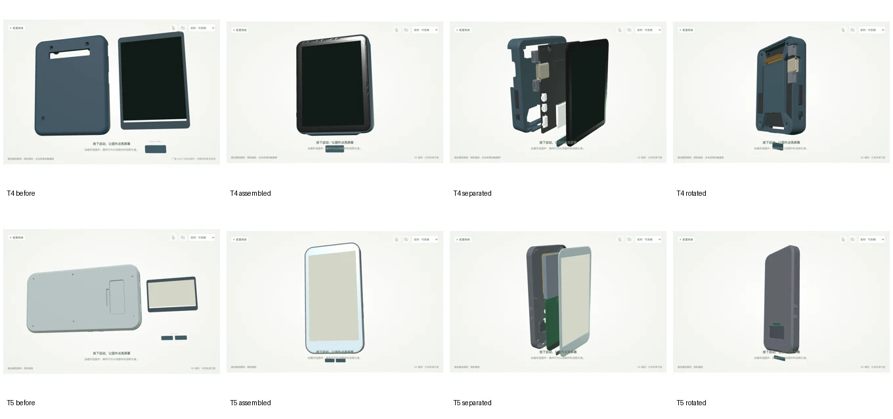

# T4-S3 与 T5 E-Paper S3 Pro 装配预览

两款设备默认以装配状态显示。选择「分开查看」可移开屏幕和外壳，露出板卡。恢复装配时，机身部件和实时屏幕都回到原位。展开距离用于观察，厂商 STEP 中的装配坐标用于正常展示。

## T4-S3

旧预览采用厂商底壳参考目录中的单件 STEP，旁边另放了实时调试屏。厂商发布的 `T4-S3-AMOLED-Full.7z` 内含屏幕、板卡、外壳和侧键的装配 STEP。新预览采用这个带壳配置，保持零件相对位置和毫米尺度。商品资料里的裸板照片可与展开后的板卡对照。[厂商底壳参考](https://github.com/Xinyuan-LilyGO/LilyGo-AMOLED-Series/tree/1f2f3fb67c646e1f8c5184a1640a4f1acc27d6f4/shell/T4-S3%20Bottom%20Housing%20Reference) · [厂商装配归档](https://github.com/Xinyuan-LilyGO/LilyGo-AMOLED-Series/blob/1f2f3fb67c646e1f8c5184a1640a4f1acc27d6f4/dimensions/T4-S3-AMOLED-Full.7z) · [商品外观与规格](https://wiki.lilygo.cc/products/t4-series/t4-s3/)

解析独立外壳包确认 `2_4_1` 是与主板轮廓重叠的壳体参考部件。完整 STEP 中另有一组与主板 TF 插座范围重叠的绘图对象。展示采用主板子装配，滤掉这些参考几何。原始 STEP 仍可重新导出。[厂商外壳归档](https://github.com/Xinyuan-LilyGO/LilyGo-AMOLED-Series/blob/1f2f3fb67c646e1f8c5184a1640a4f1acc27d6f4/shell/T4-S3-AMOLED.zip)

## T5 E-Paper S3 Pro

原有 H752 STEP 已包含盖板、外壳、机械 PCB、电池及磁环坐标。旧预览从背面看向 CAD，并将实时帧缓冲放在旁边。现在从正面展示，以 ED047TC1 的 **58.32 × 103.68 mm** 有效区和厂商正面照片定位屏幕。原生 960 × 540 帧随屏幕旋转到竖持方向，保留相同的像素比例。外壳可见颜色参照商品照片，PCB 几何沿用厂商提供的机械简化模型。[H752 STEP](https://github.com/Xinyuan-LilyGO/T5S3-4.7-e-paper-PRO/blob/87436b5c9d0d4fc09f44ef43a4fb5d41a757494a/DXF/H752.stp) · [ED047TC1 数据表](https://github.com/Xinyuan-LilyGO/T5S3-4.7-e-paper-PRO/blob/87436b5c9d0d4fc09f44ef43a4fb5d41a757494a/hardware/ED047TC1.pdf) · [商品外观与规格](https://wiki.lilygo.cc/products/t5-series/t5-e-paper-s3-pro/)

## 核对范围

| 项目 | 厂商资料 | 本次模型 |
| --- | --- | --- |
| T4-S3 正面盖板宽 × 高 | 裸板外形约 44 × 56 mm | STEP 盖板 43.92 × 56.24 mm |
| T4-S3 带壳外形宽 × 高 × 深 | 厂商 Full STEP 装配 | 46.92 × 59.24 × 12.55 mm |
| T5 E-Paper S3 Pro 外形宽 × 高 × 深 | 竖持时约 69 × 129 × 11 mm | STEP 装配 69.40 × 129.15 × 10.60 mm |

正面屏幕采用 STEP 的平面位置。有效区中心来自各自的正面照片，T4-S3 区域尺寸还使用了厂商标称 2.41 英寸对角线。浏览器打开工作台和嵌入页，检查了正面、斜侧、背面以及展开和恢复。恢复后的屏幕、盖板和板卡坐标逐项相等。按键保留独立调试区域。现有 CAD 的内部器件、丝印和材质只按可核实的范围展示。

[核对数据与复现命令](evidence/lilygo-t4-t5-assembly-2026-11-23/receipt.json)
