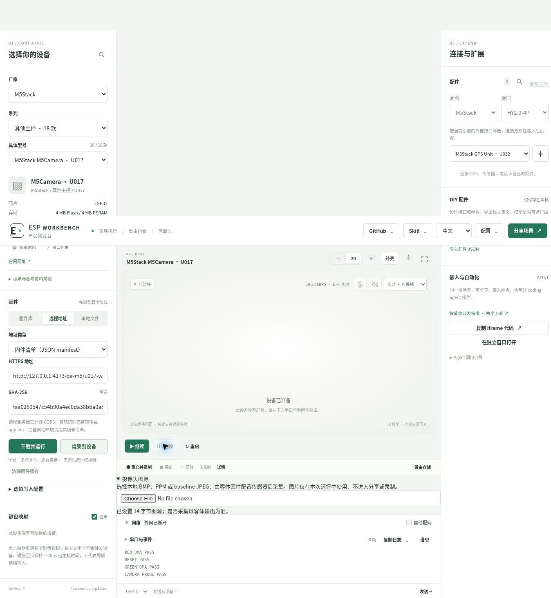
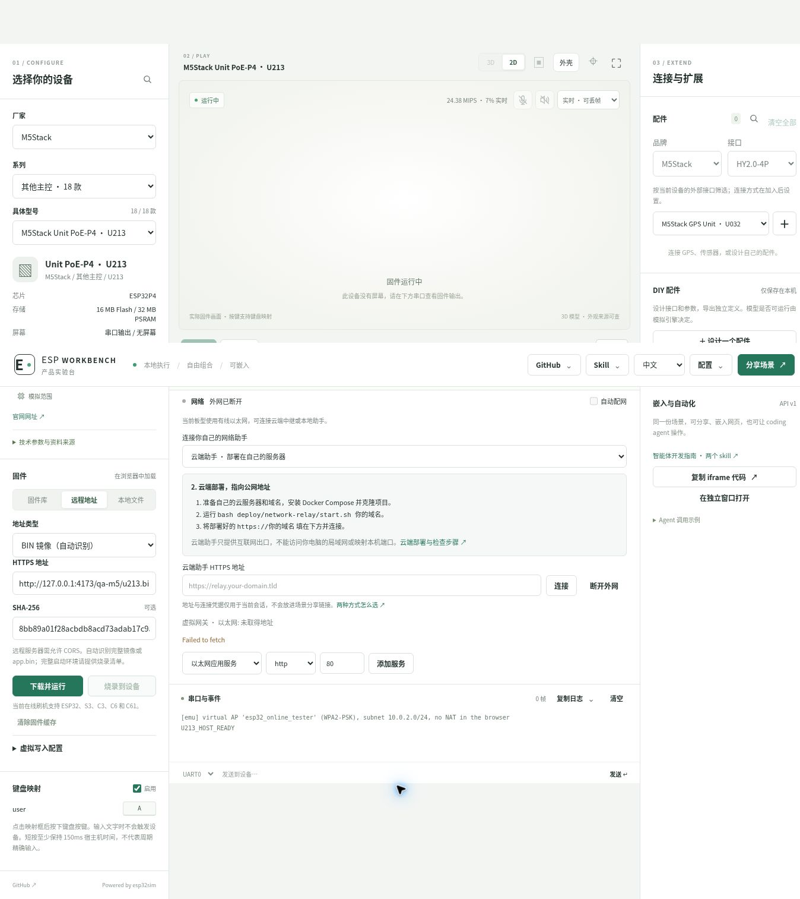

# M5 controller browser UI verification · 2026-11-26

Actual cloud Chrome opened the buildless workbench through the official managed preview. The tested JS/catalog snapshots and exact immutable Worker020 WASM hash are in [checks](evidence/m5-browser-ui-20261126/checks.json), with [initial failures and limits](evidence/m5-browser-ui-20261126/negative-results.json). Browser GPU context creation failed; actual 2D fallback, DOM controls and guest execution were tested. These results do not establish physical-device or manufacturer-firmware compatibility.

The browser check found two functional UI problems and fixes them separately:

* `d566057c`: camera controls subscribed to nonexistent `status`/`scene` notifications. Switching from StopWatch left the panel hidden. It now follows the public runtime's `state` events, including load, run and pause transitions.
* `484e524c`: a wired board still displayed STA service/router labels. The public network snapshot now exposes its implemented physical interface; the panel renders Ethernet, a virtual gateway and Ethernet application service. SoftAP and provisioning remain disabled for these boards before firmware load, and addresses still require an actual lease. Wireless labels restore on a product switch. Chinese and English are verified.

| Surface | Actual observed result | Scope |
| --- | --- | --- |
| Workbench U017 | File chooser red/green PPM → wrong SCCB/DVP, PID, red DMA, sensor reset, green DMA and final pass markers | Real mask ROM and authored LX6 diagnostic |
| Shared standalone mini | Same seven guest markers after independently choosing both pictures | Normal share restoration and trial confirmation |
| Actual 800×640 iframe | Same seven guest markers inside a real parent document | The image bytes stay outside the shared scene |
| U149 Thermal2 | UI hotspot4321 at0,0 → guest I²C RAW4321; move to31,23 → RAW1234 | Native 32×24 synthetic ADC and virtual calibration, no temperature calibration |
| U149 reset | Fresh final mask-ROM boot → RAW1000; fields1000/2000/16/12/4 | Human console keeps historical text; fresh tail is checked separately |
| TLite / original StickT | Separate labels and159×119 normalized-coordinate limits/defaults restored | UI profile checks; independent runtime receipts remain separate |
| U213 PoE-P4 | Original RV32 diagnostic reaches `U213_HOST_READY` after actual PHY checks | SRAM app-direct; no browser raw host RX or Internet claim |
| U213 storage | Open dialog shows device Flash scope; TF heading is not visible | No card or device data cleared |
| UI regression suite | 23 tests passed, zero failures | Transport/DOM state regression, separate from actual guest proof above |

The P4's unchanged `[emu] virtual AP …` line is the shared legacy VirtualNet setup banner. It is preserved in the receipt, without treating it as a Wi-Fi association or SoftAP result. Full P4 DMA TX/RX is independently documented by the production Worker020 [receipt](evidence/m5stack-p4-worker-20261126/poep4-worker020.json). The preview's cloud relay fetch failed, so no external-network success is inferred.

## Reproduce the browser inputs

Generate small original diagnostics from a caller-selected checkout and serve them under the preview's `/qa-m5/` path. The helper writes only the explicit output folder:

```sh
node tools/prepare-m5-browser-qa.mjs --repo "$PWD" --out "$M5_QA_OUTPUT" --origin "$M5_QA_ORIGIN"
```

Use the origin returned by the supported preview workflow. Choose U017, select Remote URL → JSON manifest, and enter `/qa-m5/u017-wait-picture.json` at that origin with its generated manifest SHA-256. Accept the clearly labelled trial. Use the real camera file chooser for binary P6 PPM pixels: header `P6\n1 1\n255\n`, followed by `ff0000` and then `00ff00`. Observe red/reset markers before choosing green. The diagnostic's only browser-specific adaptation waits for the human's first real red DMA frame; it does not inject framebuffer or DMA state.

Copy the iframe using the workbench's own control; images are not embedded. The helper also creates an actual iframe host using the same portable scene. For Thermal2 select its generated manifest and enter the values above. For U213 select its generated BIN with the receipt SHA, retaining the explicit app-direct boundary. Never infer a network application response from helper status or a queued input receipt.




