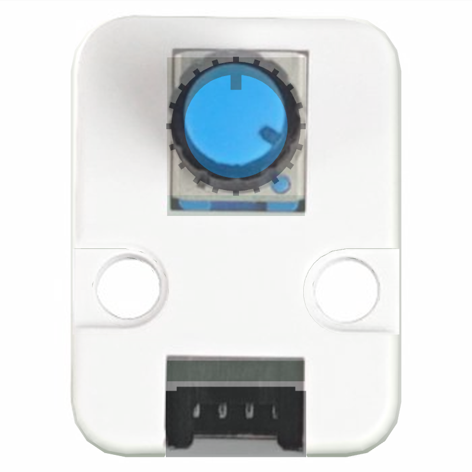
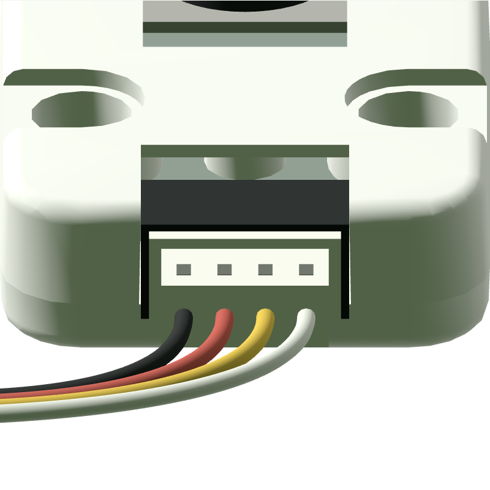
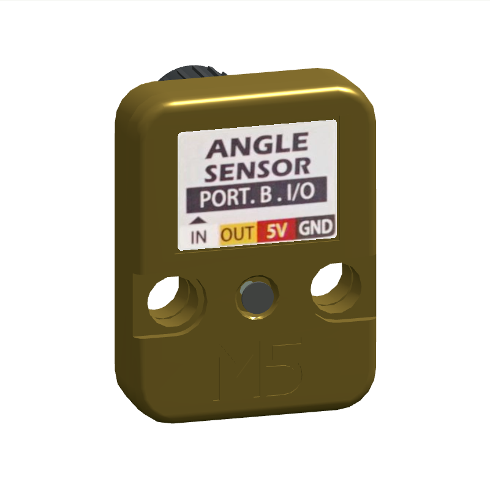
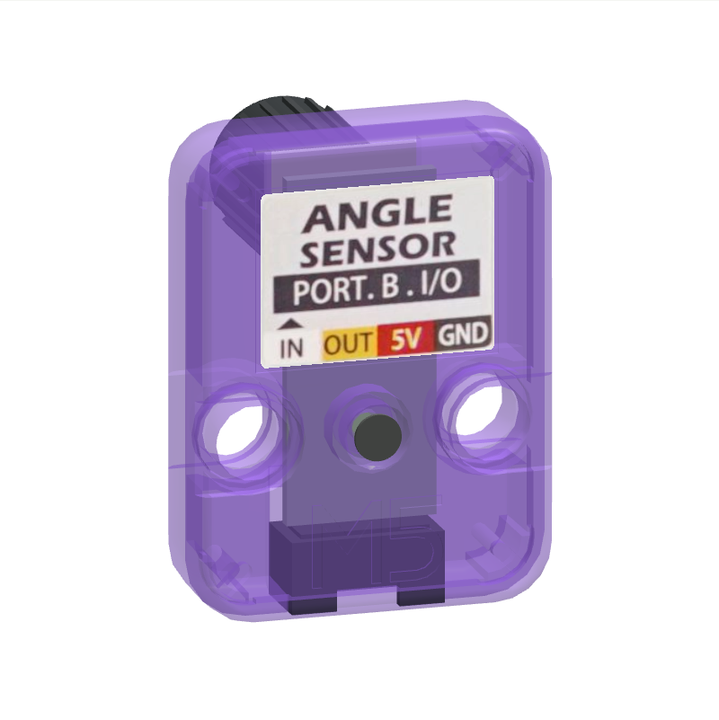
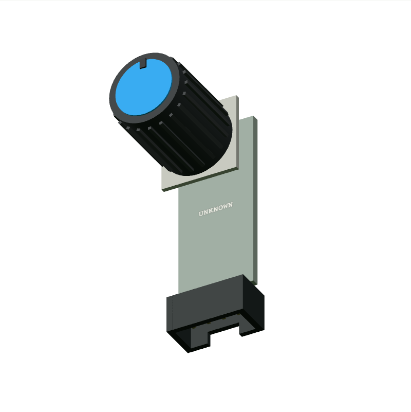

# M5Stack Unit Angle · U005 模型与资料验收

10kΩ 电位器旋钮模块，将角度转换为模拟电压。 已增加 StopWatch Port A 的标称模拟电压输入与真实 ADC2 转换；官方曲线冲突和运行证据见 [运行说明](../unit-angle-runtime.md)。

- 厂家结构：[固定提交的 STL](https://raw.githubusercontent.com/m5stack/M5_Hardware/e29c139cbc7c80b5ccc5557e5ab8025a7a19a109/Products/U005_Unit_Angle/Structures/Unit_Angle.stl)，提交 `e29c139cbc7c80b5ccc5557e5ab8025a7a19a109`。
- 产品文档：https://docs.m5stack.com/en/unit/Unit_Angle。
- 抓取时间、响应类型、字节数、SHA-256：[source-audit.json](../evidence/m5stack-unit-angle-u005/source-audit.json)；知识事实见 `web/platform/knowledge/m5stack-unit-angle-u005.json`。
- CAD 为 MIT；照片版权属于 M5Stack，没有将官方照片重新标为项目 MIT。本站保留裁剪用原图与固定区域。

Keep already assembled CAD components [0, 3]; rigid center translation and original orientation. Omit spatially separated print-layout duplicates. No scaling. +Z front, +Y top, inlet at -Y.

| 尺寸 / 来源一致性检查 | 实测 mm（source-fidelity 为误差） | 结果 |
| --- | ---: | --- |
| shell-front source-fidelity | 0.0 | 通过 |
| shell-back source-fidelity | 0.0 | 通过 |
| shell-width | 24.0 | 通过 |
| shell-height | 32.0 | 通过 |
| shell-depth | 8.0 | 通过 |

背面纸贴使用独立薄面，透明遮罩只保留实际印刷纸；塑料、安装孔、螺钉与 M5 浮雕没有烘焙进纸贴。原厂色、金色和紫色半透明均已截图检查，M5 浮雕是原厂网格，随壳体变化。Angle 旋钮为照片与尺寸约束的近似，非厂家旋钮 CAD；不能按其隐藏部位给出制造精度。

正视照片按独立照片的 32 mm 壳高统一定比例。轮廓 IoU 为 **0.94510**，0.95 阈值结果为 **未通过**；这项轮廓检验会填平孔洞，不评价印刷、钮帽、内部 PCB 或材料。参考照片镜头及精确姿态未知，背面和斜视只做定性对照。完整 1:1 验收仍为 **partial**。

插口沿采用模型 y=-16 mm、局部朝外 -Y；源照片正面左到右为黑/红/黄/白，背贴镜像为白/黄/红/黑。黑色插座和四根线逐项核对。共享插头估算插入深度 3 mm；有插入段和外部止挡。实用插接公差没有厂家连接器 CAD，仍待验证。U005 黄线为 NC，模拟输出走白线。连接可视化不构成任何电气兼容声明。

官方结构目录仅有壳体 STL，未找到 PCB 工程或布局。内部用 10×23×1 mm 空白 `UNKNOWN` 板占位，这个狭长板形只是避开已知孔洞的空间估算；只补已在外观中确认的连接器。实际 PCB 外形、元件和走线未知。

复现：安装 `tools/requirements-model.txt`，运行 `python tools/rebuild-unit-library.py m5stack-unit-angle-u005 --scratch output/unit-rebuild/m5stack-unit-angle-u005`。无需网络；所有必需输入按原始 hash 核验。仅渲染测试使用 `review-lane-01.html?id=m5stack-unit-angle-u005`，旧视觉证据对应 model.json hash `cb0459f5ffbb26b4daec883d6459bf5242a85dd54c2b7b134e81017b3a8197da`；本次仅加入可转动旋钮分组和运行范围元数据，当前 hash 为 `48e01ada4620bcbbf988f223a8c46e9c864a595b9c60a9927bdd90506a4b746f`，geometry.bin 逐字节不变，默认位置 0.5 的姿态不变。原测量时间、IoU 未通过结果保留，没有重跑或改写旧视觉结论。真实 WASM 行为检查已执行；没有实物校准。

已知限制：

- 仅支持 StopWatch Port A 白线 G11 的官方 10k 标称曲线；内部 ADC 软件模型、旋钮角度和源阻抗均未实物校准。
- 厂家 STL 保留原始尺寸，打印排版重复件已剔除；插座、螺钉及无 CAD 的外露部件为照片近似。
- 未公开 PCB 布局，内部采用 UNKNOWN 占位；贴纸使用官方照片真实印刷区域。
- 官方页面两张电路图分别标 R1=4.7kΩ 和 10kΩ；资料未标硬件版次，输出电压规格保留官网 0–2500mV，不推定所有实物一致。
- 螺钉头纹和无厂家 CAD 的旋钮为简化，照片视角存在透视误差，不声称完整 1:1 通过。
