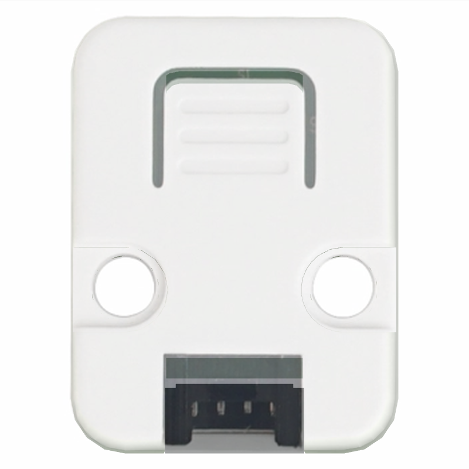
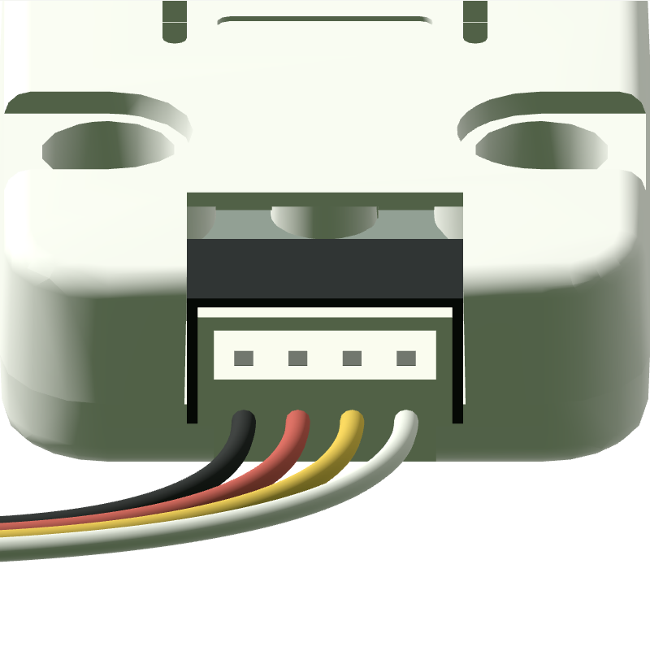
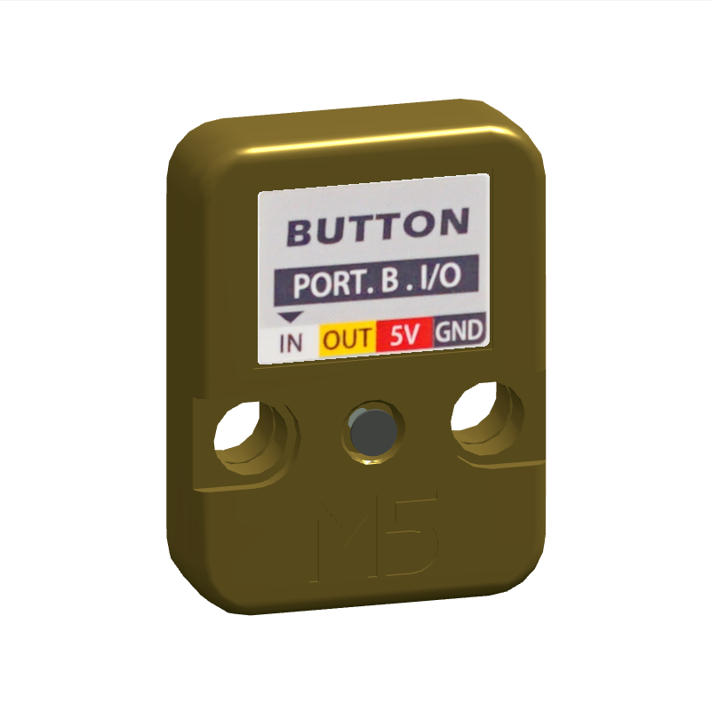
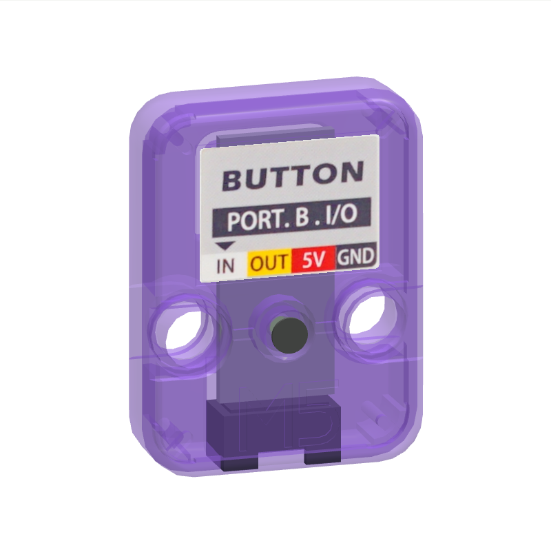
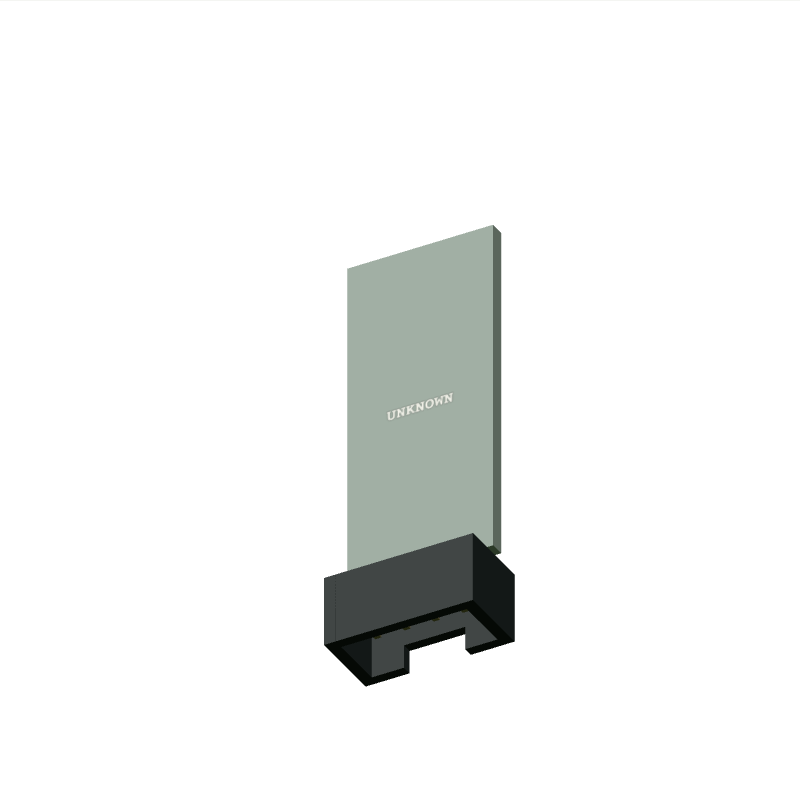

# M5Stack Unit Button · U027 模型与资料验收

单按键数字输入模块，低电平表示按下。 已增加 StopWatch Port A 上的 U027 V1.0 数字稳态行为，3D 按钮、面板和 API 均驱动真实 GPIO11。范围与测试见[运行模型](../unit-button-runtime.md)。

- 厂家结构：[固定提交的 STL](https://raw.githubusercontent.com/m5stack/M5_Hardware/e29c139cbc7c80b5ccc5557e5ab8025a7a19a109/Products/U027_Unit_Button/Structures/Unit_Button.stl)，提交 `e29c139cbc7c80b5ccc5557e5ab8025a7a19a109`。
- 产品文档：https://docs.m5stack.com/en/unit/Unit_Button。
- 抓取时间、响应类型、字节数、SHA-256：[source-audit.json](../evidence/m5stack-unit-button-u027/source-audit.json)；知识事实见 `web/platform/knowledge/m5stack-unit-button-u027.json`。
- CAD 为 MIT；照片版权属于 M5Stack，没有将官方照片重新标为项目 MIT。本站保留裁剪用原图与固定区域。

Keep already assembled CAD components [0, 3]; rigid center translation and 180 degree Y rotation for front normal. Omit spatially separated print-layout duplicates. No scaling. +Z front, +Y top, inlet at -Y.

| 尺寸 / 来源一致性检查 | 实测 mm（source-fidelity 为误差） | 结果 |
| --- | ---: | --- |
| shell-front source-fidelity | 0.0 | 通过 |
| shell-back source-fidelity | 0.0 | 通过 |
| shell-width | 24.0 | 通过 |
| shell-height | 32.0 | 通过 |
| shell-depth | 8.0 | 通过 |

背面纸贴使用独立薄面，透明遮罩只保留实际印刷纸；塑料、安装孔、螺钉与 M5 浮雕没有烘焙进纸贴。原厂色、金色和紫色半透明均已截图检查，M5 浮雕是原厂网格，随壳体变化。按压弹片沿用原厂 STL，控制区域按官方照片标出的 Press Here 与尺寸图定位。

正视照片按独立照片的 32 mm 壳高统一定比例。轮廓 IoU 为 **0.98742**，0.95 阈值结果为 **通过**；这项轮廓检验会填平孔洞，不评价印刷、钮帽、内部 PCB 或材料。参考照片镜头及精确姿态未知，背面和斜视只做定性对照。完整 1:1 验收仍为 **partial**。

插口沿采用模型 y=-16 mm、局部朝外 -Y；源照片正面左到右为黑/红/黄/白，背贴镜像为白/黄/红/黑。黑色插座和四根线逐项核对。共享插头估算插入深度 3 mm；有插入段和外部止挡。实用插接公差没有厂家连接器 CAD，仍待验证。本轮仅将 StopWatch Port A 的白线 G11 接入 U027，黄线 G10 在 U027 原理图中为 NC。其他主机仍仅可展示，不由连接外观推断电气兼容。

官方结构目录仅有壳体 STL，未找到 PCB 工程或布局。内部用 10×23×1 mm 空白 `UNKNOWN` 板占位，这个狭长板形只是避开已知孔洞的空间估算；只补已在外观中确认的连接器。实际 PCB 外形、元件和走线未知。

复现：安装 `tools/requirements-model.txt`，运行 `python tools/rebuild-unit-library.py m5stack-unit-button-u027 --scratch output/unit-rebuild/m5stack-unit-button-u027`。无需网络；所有必需输入按原始 hash 核验。仅渲染测试使用 `review-lane-01.html?id=m5stack-unit-button-u027`，当前 model.json hash 为 `47b7d53d0bcbc8e5f64980e1c892d4f0c9002e9dad337c983de4f20d1d1acdb2`。本轮将前壳中 256 个原有三角面分为 button-cap；3908 个三角面及法线的多重集逐位一致，没有增加命中盒或改动几何。旧轮廓测量时间、指标和 hash 保留于 verification.json；本轮复用视觉几何证据，不将旧叠图描述为新测量。公开工具的 scratch 重建与当前产物一致，见 [model-rebuild.json](../evidence/m5stack-unit-button-u027/runtime/model-rebuild.json)。真实 WASM 输入测试已通过，未做真实硬件测试。

已知限制：

- U027 V1.0 + StopWatch Port A 的按键、供电和拔插已有定向固件证据；其他主机、RC 延迟、触点抖动和模拟电气争用未实现。
- 厂家 STL 保留原始尺寸，打印排版重复件已剔除；插座、螺钉及无 CAD 的外露部件为照片近似。
- 未公开 PCB 布局，内部采用 UNKNOWN 占位；贴纸使用官方照片真实印刷区域。
- 螺钉头纹及无厂家 CAD 的连接器为简化，照片视角存在透视误差，不声称完整 1:1 通过。
