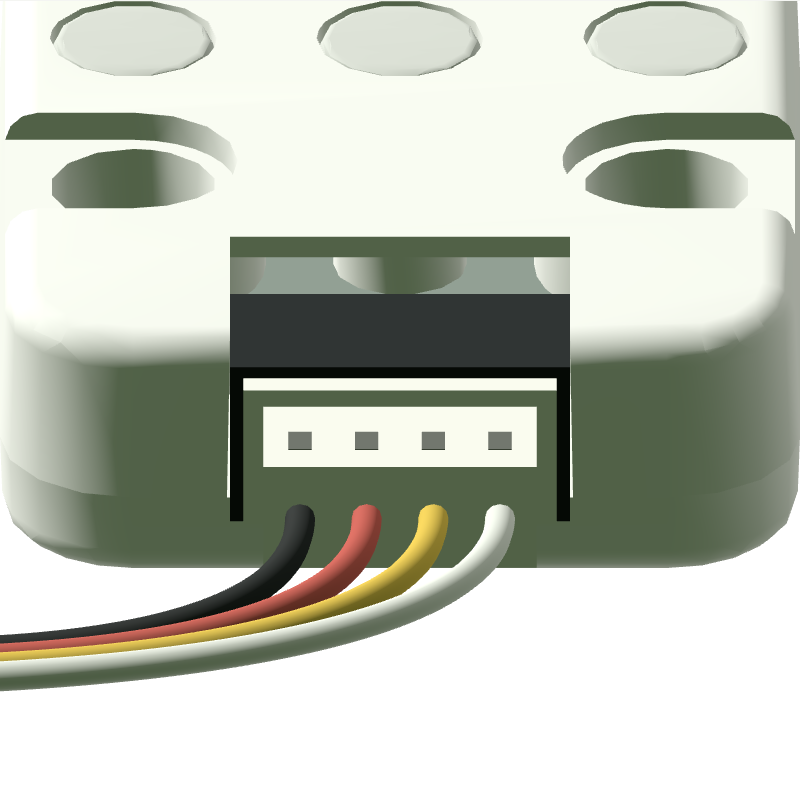
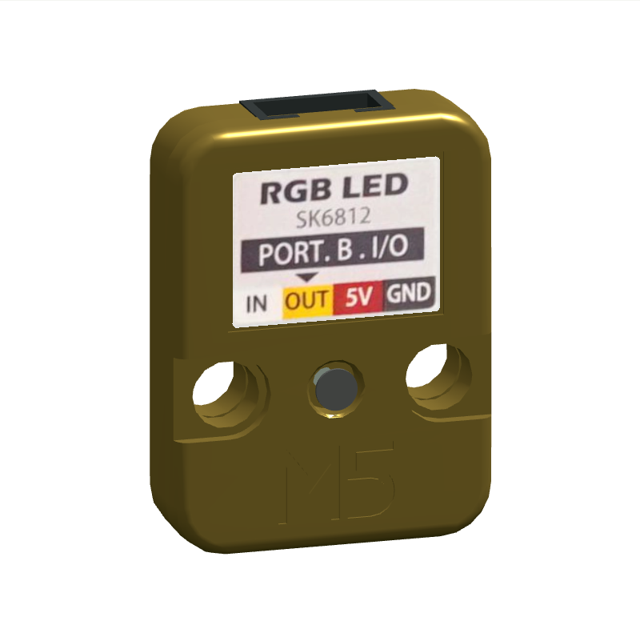
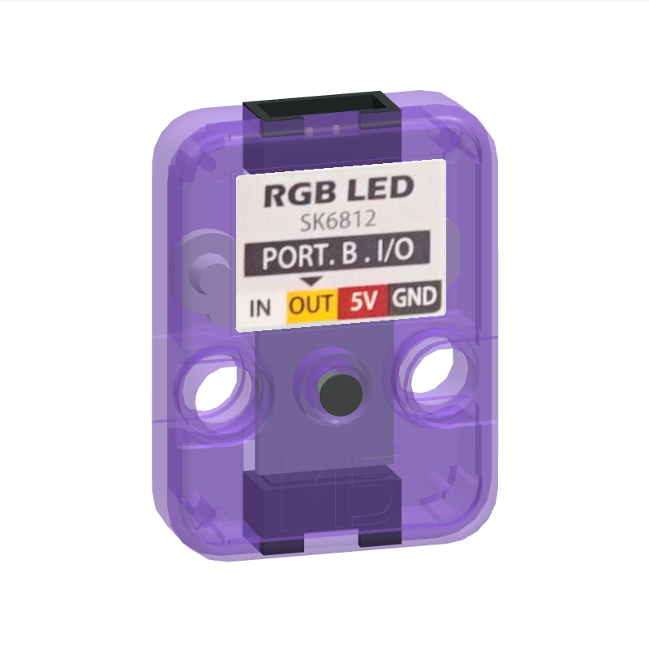
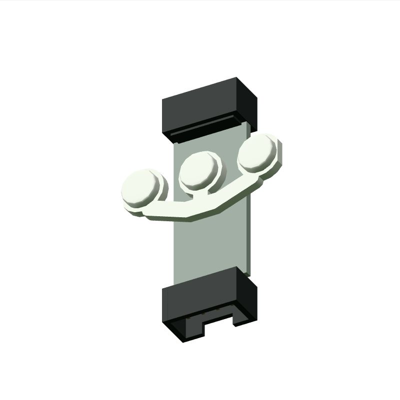

# M5Stack Unit RGB · U003 模型与资料验收

包含三个 SK6812 RGB LED 的灯光模块，可用串行数据控制。 现已支持 StopWatch Port A 上的三颗灯 RMT 输出与供电门控，详见 [U003 行为范围](../unit-rgb-runtime.md)。

- 厂家结构：[固定提交的 STL](https://raw.githubusercontent.com/m5stack/M5_Hardware/e29c139cbc7c80b5ccc5557e5ab8025a7a19a109/Products/U003_Unit_RGB/Structures/Unit_RGB.stl)，提交 `e29c139cbc7c80b5ccc5557e5ab8025a7a19a109`。
- 产品文档：https://docs.m5stack.com/en/unit/Unit_RGB。
- 抓取时间、响应类型、字节数、SHA-256：[source-audit.json](../evidence/m5stack-unit-rgb-u003/source-audit.json)；知识事实见 `web/platform/knowledge/m5stack-unit-rgb-u003.json`。
- CAD 为 MIT；照片版权属于 M5Stack，没有将官方照片重新标为项目 MIT。本站保留裁剪用原图与固定区域。

Keep already assembled CAD components [3, 4, 0]; rigid center translation and original orientation. Omit spatially separated print-layout duplicates. No scaling. +Z front, +Y top, inlet at -Y.

| 尺寸 / 来源一致性检查 | 实测 mm（source-fidelity 为误差） | 结果 |
| --- | ---: | --- |
| shell-front source-fidelity | 0.0 | 通过 |
| shell-back source-fidelity | 0.0 | 通过 |
| led-diffuser source-fidelity | 0.0 | 通过 |
| shell-width | 24.0 | 通过 |
| shell-height | 32.0 | 通过 |
| shell-depth | 8.0 | 通过 |

背面纸贴使用独立薄面，透明遮罩只保留实际印刷纸；塑料、安装孔、螺钉与 M5 浮雕没有烘焙进纸贴。原厂色、金色和紫色半透明均已截图检查，M5 浮雕是原厂网格，随壳体变化。三颗灯的显示分组复用原厂 diffuser 网格；链序对应左右灯孔的位置尚缺实机校准。

正视照片按独立照片的 32 mm 壳高统一定比例。轮廓 IoU 为 **0.98492**，0.95 阈值结果为 **通过**；这项轮廓检验会填平孔洞，不评价印刷、钮帽、内部 PCB 或材料。参考照片镜头及精确姿态未知，背面和斜视只做定性对照。完整 1:1 验收仍为 **partial**。

插口沿采用模型 y=-16 mm、局部朝外 -Y；源照片正面左到右为黑/红/黄/白，背贴镜像为白/黄/红/黑。黑色插座和四根线逐项核对。共享插头估算插入深度 3 mm；有插入段和外部止挡。实用插接公差没有厂家连接器 CAD，仍待验证。RGB 上端输出口的物理线序未独立确认，不启用该口的连接线。连接可视化不构成任何电气兼容声明。

官方结构目录仅有壳体 STL，未找到 PCB 工程或布局。内部用 10×23×1 mm 空白 `UNKNOWN` 板占位，这个狭长板形只是避开已知孔洞的空间估算；只补已在外观中确认的连接器。实际 PCB 外形、元件和走线未知。

复现：安装 `tools/requirements-model.txt`，运行 `python tools/rebuild-unit-library.py m5stack-unit-rgb-u003 --scratch output/unit-rebuild/m5stack-unit-rgb-u003`。无需网络；所有必需输入按原始 hash 核验。仅渲染测试使用 `review-lane-01.html?id=m5stack-unit-rgb-u003`，证据对应当前 model.json hash `31a0024e42100896789a899c8ed25812c4185b5b54a7b7a3d50e7444ede89222`。本轮进行了内部源码固件真实 WASM 行为测试；未测试实体硬件。

已知限制：

- StopWatch Port A 黄线 G10 的客体 RMT 输出已实现；需固件开启 Grove 5V。软件 GPIO 波形、串级出口和模拟电流未实现。
- 厂家 STL 保留原始尺寸，打印排版重复件已剔除；插座、螺钉及无 CAD 的外露部件为照片近似。
- 未公开 PCB 布局，内部采用 UNKNOWN 占位；贴纸使用官方照片真实印刷区域。
- 官方 pinmap 把白线标为 NC；串级原理图白线 DI 连通两端，本轮不模拟串级、不启用输出端连线。
- 螺钉头纹和无厂家 CAD 的旋钮为简化，照片视角存在透视误差，不声称完整 1:1 通过。
