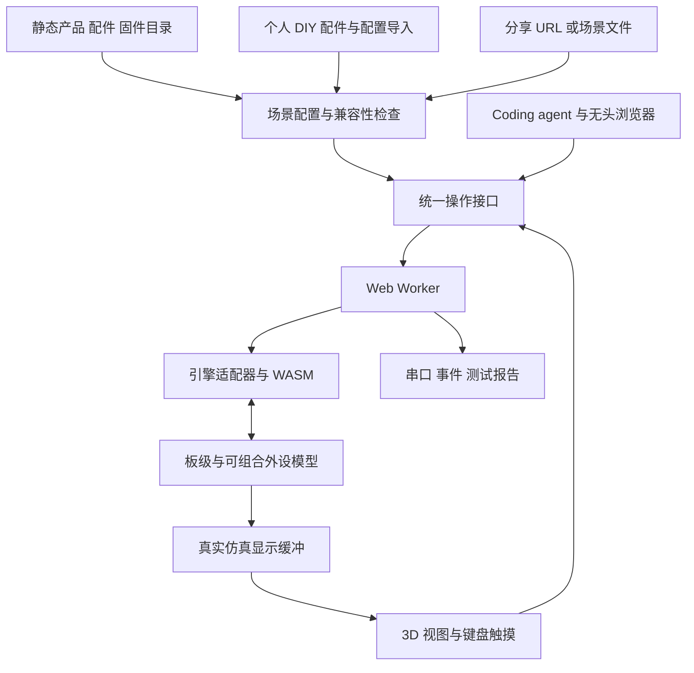

# ESP Online Tester 系统架构草案

本文定义目标系统，不代表接口已实现。前端与目录可以独立推进；完整固件执行以 [后端和硬件验证门槛](validation-plan.md)为前提。

## 运行结构

建议使用 TypeScript、Vite、React、Three.js、JSON Schema 校验、IndexedDB。模型采用 glTF/GLB。这是一套实现选择，不要求固定某个 UI 组件库。

单个 Worker 拥有 CPU 和所有需要同步响应的外设模型。SPI/I²C 读响应必须在固件继续消费结果之前返回，不能先把请求送主线程、让固件继续执行、再补数据。首期采用内置 Rust 模型；未来 JS 模型需要同 Worker 同步桥接，或明确的暂停/恢复协议。

主线程只处理 UI 和渲染。显示数据用 transferable buffer 或脏区批量传输；输入含仿真时间和递增序号。3D 动画帧率与 CPU 调度分开，降低模型画质不能改变固件执行语义。第二个虚拟 ESP 是另一个 CPU 实例，不可仅把它登记为普通无源配件。

## 三类公共目录与个人工作区

用户提到的最后一个“配件库”按“固件库”处理。产品、配件、固件各自独立，场景负责把它们组合起来。

| 类型 | 必要字段 | 重要区别 |
| --- | --- | --- |
| Product | 稳定 ID、厂商、SKU、硬件修订、SoC/ISA、Flash/PSRAM、引脚、板载器件、接口、尺寸、官方资料、模型资产、支持状态 | 产品与同芯片开发板不能合并；板载芯片也要建模 |
| Accessory | ID/修订、连接器、供电/逻辑电平、引脚方向、总线/地址/串口配置、行为模型 ID/版本、可调参数、来源 | 物理插头相同不代表电气或协议兼容 |
| Firmware | ID/版本、项目页/许可、目标产品及修订、镜像格式、各段 URL/offset/size/hash、必要资源、依赖能力、验证记录 | 项目支持 ESP32-S3 不等于该二进制适合全部 S3 产品 |
| Scene | 产品实例、配件实例、连线、固件解析结果、输入映射、环境、视图、引擎及目录版本 | 是可复现配置；不是商品条目，也不是 CPU 快照 |

每个引用使用稳定 ID 加具体 revision；展示名可以改。硬件资料来源和确认日期随条目存放，代码许可、固件许可、照片和 3D 模型许可分开记录。产品目录第一版只录入用户的两款主机与 GPS 两代，数据结构允许以后通过 PR 扩展整个 ESP 家族。

接口应表达 `connector`、`contacts`、`supply`、`logicVoltage`、`powerDomain`、`allowedFunctions`、`defaultFunction`。信号按设备视角标 TX/RX，并在连线图显式表示 TX→RX。板载显示复位可能接在 IO 扩展器上，不能一律写成 ESP GPIO。

显示资产记录 `ramSize`、`visibleRect`、`stride`、`pixelFormat`、`rotation`、`touchTransform` 和 3D 屏幕表面。键盘记录矩阵、行列引脚、按键逻辑与组合键；按键记录真实线路、有效电平和电源键特殊行为。

### 兼容性状态

目录收录状态与仿真支持状态分开。建议支持标签：

- `metadata-only`：仅完成资料整理。
- `model-partial`：已有部分器件模型，缺口明确。
- `boot-verified`：某个固定哈希固件完成启动。
- `interaction-verified`：该组合通过屏幕、输入或外设交互场景。
- `hardware-compared`：特定场景已与指定硬件修订版对照。
- `unsupported`：当前后端不能实现必要功能。

验证记录绑定 engine commit、模型版本、板型修订、固件哈希、场景哈希、浏览器与证据文件，标签不能无条件继承给新固件。内部设备的 `stub`、`functional`、`timing-approximate` 等建模等级也要随结果公开。提供全零 I²C 应答只可能帮助启动，不能声称触摸或传感器已通过。

## 固件加载

支持两类正式输入：完整 Flash 镜像；包含 bootloader、partition table、app、数据分区及各自 offset 的 manifest。单独 app/OTA `.bin` 只有在知道匹配的启动器、分区和其他数据时才能运行，不猜统一地址。可兼容导入 ESP Web Tools manifest，但仍需补上本系统的硬件与能力约束。

加载过程：解析来源 → 校验大小/类型/哈希 → 检查芯片与镜像头 → 检查段重叠和 Flash 越界 → 解析分区 → 确定完整启动链 → 检查所需外设 → 装载 Worker。合并空洞填 0xFF；额外的文件系统/SD 卡镜像必须显式声明。

Secure Boot、Flash Encryption、芯片修订和 eFuse 配置按独立能力检查，不假设裸 `.bin` 足够。用户上传的 Flash/NVS/SD 内容留在本地；分享默认仅含配方，不带账号、Wi-Fi 密钥或私人存储内容。

远程输入只作为数据读取，不执行远程 URL 指定的 JS。固定 SHA-256 和版本；`latest` 只能用于发现，执行与分享时解析到具体版本。允许用户显式输入远程 HTTPS 地址，并记录重定向后的来源；限制下载与解压尺寸，拒绝 HTML 登录页假扮固件。

失败时给出可操作原因：CORS、URL 失效、仅有 OTA app、芯片不符、缺少启动镜像、缺少外设、存储容量不符。没有兼容模型时仍可浏览产品，但运行按钮必须解释缺口。

知名固件初始候选为官方 PaperMono/StopWatch 示例、[CrossPoint Reader 的 PaperMono 版本](https://github.com/crosspoint-reader/crosspoint-reader/releases)、[M5Launcher 的 PaperMono 版本](https://github.com/bmorcelli/Launcher/releases)。这些是候选项目，尚未解析和验证具体镜像；原厂整机 demo 可能一次初始化很多外设，不宜作为第一条启动用例。Wi-Fi、SD、音频等依赖逐项声明。

## 3D 操作和独立展示

外壳可由厂家结构文件转为轻量 GLB，也可先按尺寸建立简化几何体；记录资产来源和许可。屏幕纹理来自外设模型生成的 framebuffer，不能用前端计时器画假 UI 充当固件运行证据。

射线拾取按钮、旋钮和屏幕；触点从模型 UV 经裁剪和旋转变换到屏幕坐标，再进入触控芯片模型。圆屏处理不可见区域；墨水屏把 RAM 更新、刷新命令和 BUSY 分开，刷新中的视觉反馈不能替代真实总线状态。电源键、长按、双击应遵循板型逻辑。

同时保留 2D 屏幕视图与可访问的 DOM 控件，便于低性能设备和测试定位。键盘映射使用 `KeyboardEvent.code`，支持按下/抬起、长按、组合键与重映射；输入框聚焦时不抢键，窗口失焦时释放全部按键，避免“卡住”。矩阵键盘的文字输入与物理按键不是同一种能力。

独立展示入口采用真实静态文件 `viewer.html`，隐藏目录和编辑器。完整编辑器可用 hash 路由，避免 GitHub Pages 深链接 404。新窗口由用户点击打开；真正进入浏览器全屏也由用户操作触发，URL 的 `view=fullscreen` 只决定页面布局。[Fullscreen API](https://developer.mozilla.org/en-US/docs/Web/API/Fullscreen_API)

## 分享与存储

短配置可放在 `viewer.html#s=<base64url(压缩后的规范化场景)>`。较大的场景放入公开 JSON，使用 `viewer.html#manifest=<编码URL>&sha256=<摘要>`；二者是拟议格式，未上线。已有公共场景还可使用仓库内固定 revision 的 ID。

分享必须固定产品/配件/固件/引擎版本和输入映射；配件参数、连线和环境也在其中。固件仍从受信且可 CORS 读取的固定地址下载，不把几十 MB 二进制塞进 URL。导入时限制压缩前后大小及对象数量。

“配置分享”表示新开一次相同配置的运行；“操作回放”额外携带时间轴和随机种子；“运行快照”则需要 CPU、RAM、Flash 和各外设完整序列化。首版只承诺前两者，且回放可复现性须经后端验证，不用浏览器缓存冒充快照。

IndexedDB 保存个人产品草稿、DIY 配件、场景和文件缓存。浏览器可能清理这些数据，因此提供显式导入/导出，离线副本不等于跨设备同步。引用本机 blob 的场景标记为“需补充本地文件”；DIY 定义若不内嵌或随文件导出，收件人的链接就不能独立还原。

## DIY 配件工具

首版做参数化行为编辑器：选择模板、设置连接器/引脚/供电、定义寄存器或串口协议、设置可调参数，再预览和导出。

模板优先级：按钮/LED → UART GPS/NMEA 回放 → I²C 寄存器设备 → 现有屏幕/传感器模型参数化。GPS 参数包括固定位置或轨迹、UTC 起点、更新频率、定位有效性、卫星数、HDOP、丢包、校验错误和重新定位。只有实现了的字段才开放为可测试参数。

模板和状态机 DSL 在 WASM 内由解释器执行，或由同 Worker 中审核过的实现运行；不允许任意分享链接悄悄加载第三方 JS。更复杂的新芯片需要模型代码和发布版本，不能承诺画一个外壳、填 JSON 就能模拟任何器件。

个人配件 ID 使用 `local:` 命名空间，存个人工作区，不进主库。导出得到独立包，含 manifest、声明式行为、资产引用、版本和哈希。将来用户选择贡献时，可生成待 PR 的目录；不从网页保存动作自动提交 PR。

## PR 与构建发布

建议目录：`catalog/products/`、`catalog/accessories/`、`catalog/firmwares/`、`catalog/scenarios/`、`models/`、`schemas/`、`packages/engine-adapters/`、`packages/automation/`、`skills/`。目录记录与可执行模型分开审核。

PR 检查 JSON Schema、唯一 ID、引用完整性、电压/引脚/地址冲突、模型版本、哈希、资源大小、来源和许可；有运行声明的条目必须带可复现测试。模型代码变更增加协议测试和固定固件回归；远程固件可达性与 CORS 在浏览器来源下检查。CI 不用带发布凭据的作业执行未信任 PR 代码。

合并后 Actions 生成版本化 JSON 索引和静态站点。网站读构建产物，不需要运行时 GitHub Token 或 API 搜索。新模型经编译发布后才被目录引用；不存在的模型不能通过数据 PR“变成可运行”。

采用引擎适配层和能力协商：对外保持统一操作，对内分别实现 esp32sim、esp-emulator 或其他后端。引擎不支持的操作返回结构化错误，不悄悄改固件、不在 UI 中伪造成功。
