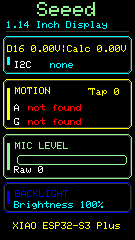
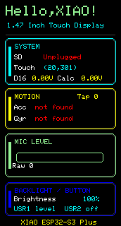
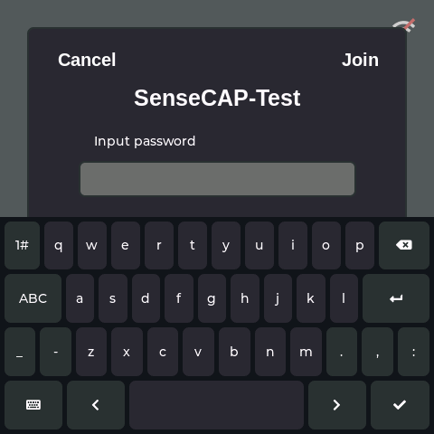

# Seeed：最终共享 WASM 的 12 机回归

2026-11-22，在 EE 面板驱动和 Watcher 旋钮输入时序整合后，通过真实平台 loader、
`runtime.js`、worker 与生产 WASM，重新执行原有 12 款设备的目录默认镜像。
**12 次均从 ROM 启动，固件未修改，没有 application-direct 或函数桩。**
16 个输入动作产生 29 次捕获请求：26 张实际 framebuffer 与旧收据逐字节一致，
另 3 次仍返回 `NO_FRAME`。各设备的官方固件、ROM、ZIP 成员和初始 Flash 摘要
也全部与旧收据一致。

回归一致包含已知失败：三款 IPS 和 Indicator 通过下表所列显示与输入子集；
Watcher、TRMNL S3 和 E1003 能显示真实页面，但完整流程未验证；C3、Sticky、
E1001、E1002、E1004 在本窗口内没有可用的默认 UI。目录继续保持 `partial`，
并保留 `simulationVerified:false` 与 `hardwareValidated:false`。

完整数值、输入回执、原始捕获摘要、历史对照及明确失败项在
[执行收据](evidence/seeed-final-wasm-20261122/receipt.json)。这是 Node 承载的实际
worker/WASM 验证，不是浏览器 DOM/WebGL/CORS、实体硬件、云功能或性能验收。

## 可执行文件与输入身份

| 项目 | 本次值 |
| --- | --- |
| WASM 大小 | 6,026,506 字节 |
| WASM SHA-256 | `1002b80d7336ee0e610eedad8b9688fc5389bb1bcaeadf48c02d279069181a24` |
| Worker SHA-256 | `f2903f82105003582d2ccde163c3dbfbc1c61d980c542fd9c0a5a69803af960d` |
| Probe SHA-256 | `2fbbb469c80d9c6854a0d83d507fccf27efbe68f2f355a7a179628b9495f7e83` |
| 历史对照 WASM SHA-256 | `9089bd6c056e2c3752b4f04db2b7053e640aa98039c3ddc455b6a5273621f03f` |

每台启动前后都核验 WASM、worker 和 probe 三个摘要。构建来源 `c629bc9` 是尚未
发布的整合检查点；发布历史可能整合为一个提交，以上可执行文件和输入摘要才是
本次观察的复现身份。旧结果保留在 [七机记录](seeed-wasm-runtime.md) 和
[五款 reTerminal 记录](seeed-reterminal-runtime.md)，未覆盖旧采样时间或指令数。

`runtime.js` 在本批保持 SHA-256
`235aad80b42ba0c75f1c411680196042406d22d1fbc7b3596928ef8e519ecbdb`。
独立的 ZIP helper 在批次期间调整了容器额度，未按每个进程冻结；收据保存其前后
两个源码摘要，并验证全部所选原始容器、成员与装配 Flash 的身份不变。本记录
限于冻结的共享 WASM/worker 回归，不涵盖随后整合的 ZIP 容器缓存改动。

官方原始下载经调用者提供的本地 URL map 读取，保持平台正常的 SHA、芯片和布局
检查，禁止访问未映射远程地址。第三方固件未加入仓库。每次使用隔离的空白内存
Flash；声明卡槽的产品按平台合同准备 64 MiB FAT32 卡，没有清除用户已有数据。

## 逐设备结果

“启动捕获”是输入前第一帧的实际客体时间；后续输入的时间、指令数、帧数另见
收据。电子纸的 6 秒和 8 秒窗口与旧记录部分不同，因此保留两组实际时间，不将
画面相同说成执行工作量相同。

| 设备及目录默认镜像 | 启动捕获 | 实际观察 |
| --- | ---: | --- |
| XIAO 0.96 英寸 IPS，官方 factory ZIP | 6.02 s | 原厂仪表页；75% 亮度后的均值比例为 0.739085，熄屏后所有像素为黑，再按恢复此前降亮度画面。 |
| XIAO 1.14 英寸 IPS，factory 1.2.4 | 6.02 s | 第三键将标题改为 `Seeed`，改变 592 像素；亮度比例 0.731580，熄屏和恢复有效。 |
| XIAO 1.47 英寸触屏，factory 7.14 | 6.00 s | 固件读到 `(20,301)`；按住时改变 119 像素，释放后准确恢复启动帧。亮度比例 0.733213，熄屏和恢复有效。 |
| SenseCAP Indicator D1 GX，factory 1.0.0 | 8.10 s | 480×480 Wi-Fi 列表；触摸 `(200,136)` 打开原厂密码键盘，改变 205,305 像素。 |
| SenseCAP Watcher W1-B，factory 1.1.7 | 8.30 s | 412×412 欢迎页，38,136 个非黑像素；跳过触摸、一个旋钮步进及旋钮按键都没有改变画面。 |
| TRMNL 7.5 英寸 OG DIY / S3，TRMNL 1.8.19 | 8.30 s | 800×480 配网页面，8,639 黑像素；D4 短按后画面不变，完整按键流程未验证。该项目镜像不冒充原始出厂身份。 |
| XIAO 7.5 英寸 / C3，TRMNL 1.8.19 | 10.00 s | 8.950 s 再次出现 `RTCWDT_RTC_RESET`；捕获的 384,000 像素全白，没有可用 UI。 |
| reTerminal E1001，SenseCraft HMI 1.1.5 | 6.02 s | `NO_FRAME`；固件报告屏幕、TF 初始化成功，电量 92%，随后进入 Wi-Fi 初始化。 |
| reTerminal E1002，SenseCraft HMI 1.1.5 | 6.02 s | `NO_FRAME`；屏幕、TF 初始化成功，电量 92%，随后进入 Wi-Fi 初始化。 |
| reTerminal E1003，SenseCraft HMI 1.1.5 | 6.00 s | 1404×1872 原厂低电量页面，47,141 个非白像素；文字和电池图标可读。 |
| reTerminal E1004，SenseCraft HMI 1.1.5 | 8.04 s | `NO_FRAME`；屏幕、TF 初始化成功，电量 94%，随后进入 Wi-Fi 初始化。 |
| reTerminal Sticky，官方恢复 1.2.0 | 8.00 s | 800×480 全白；显示和 TF 初始化完成，`/storage` 与字体文件加载持续失败。 |

亮度数值是客体设置所对应的 framebuffer 均值比，不是实体屏幕光学测量。1.14
英寸使用换标题后的满亮度帧作基准。0.96 英寸原始二进制仍同时输出 1.13.3
介绍横幅和 1.13.1 启动完成行；保留这个版本标示冲突，按固定镜像摘要识别。

Indicator 使用公开的合成 `SenseCAP-Test` 路由器配置，关闭外网和自动配网。
没有输入密码或执行加入网络。触摸改变画面证明所列本地 UI 导航，不证明联网。

### 保留的失败边界

Watcher 本次使用新的 20 ms 编码器相位，但默认原厂欢迎页仍未产生可见导航。
日志还包含缺失 factory NVS、SPIFFS `-10025` 和固件报告的 89% 电量。输入被
接受只说明排队成功；本收据没有把三次不变画面升级为导航通过。小智是另一个
固定镜像，其独立音量输入观察不能替换本次 factory 1.1.7 的负结果。

C3 的复位时间与旧 WASM 观察仍是 8.950 s；原生运行的约 8.749 s 属于另一条
历史观察。这里没有用伪造用户按键或前端画面填补现有 C3 light-sleep/看门狗缺口。

E1001、E1002 和 E1004 的电量是已注明的板级标称电池输入经过客体算法得到的值。
Wi-Fi 初始化是最后观察到的阶段，仅凭这条日志不能确定随后确切阻塞的寄存器或
指令。此前显式 `ADC=0` 的 native 低电量页面是独立测试条件，不能代替默认启动。

E1003 保持原生竖向安装；原厂横向低电量页面因此侧向显示，未为截图旋转或改写。
PMIC、触摸和正常 UI 未通过验收。Sticky 全白属于无有效 UI，字体错误仍保留。

## 本次原始画面

以下 PNG 仅对实际 RGBA framebuffer 做无损编码，解码后的摘要与捕获值一致。
没有加标签、改颜色、调整方向或替换屏幕内容；图片均已目视检查，不含设备标识。








TRMNL S3 的配网页面包含生成的设备 SSID 和 QR 码，不发布其 PNG；完整像素摘要和
统计仍保留。白色帧与 `NO_FRAME` 没有用示意图替代。所有原始串口、网络状态及
存储键均未提交，收据保留其原始摘要和经过审阅的必要标记。

## 复现

先按仓库说明构建 WASM 并取得官方 ROM。12 个精确型号、启动时间和输入计划列在
[runs.json](evidence/seeed-final-wasm-20261122/runs.json)，所有输入文件一并保留。
例如：

```sh
ESP32SIM_ROM_DIR="$ROM_DIR" node tools/probe-seeed-runtime.mjs \
  --product seeed-xiao-ips-147 --seconds 6 \
  --inputs docs/platform/evidence/seeed-final-wasm-20261122/inputs/seeed-xiao-ips-147.json \
  --output target/seeed-final-wasm/seeed-xiao-ips-147

ESP32SIM_ROM_DIR="$ROM_DIR" node tools/probe-seeed-runtime.mjs \
  --product seeed-reterminal-e1003 --seconds 6 \
  --output target/seeed-final-wasm/seeed-reterminal-e1003
```

Indicator 还需传入
`--network-json docs/platform/evidence/seeed-final-wasm-20261122/inputs/indicator-network.json`。
调用者已有原始下载时，可添加 `--local-map "$CALLER_URL_MAP" --local-only`，正常
SHA 和布局校验仍执行。复现输出包含原始串口与画面，发布前应单独审阅。

本批不记录主机吞吐或 CPU 时间，运行时还存在独立的编译和其他功能验证。性能
验收使用单独的安静时段和相同原生 release 配置。先前 17 份 EE 默认固件的
[真实启动收据](evidence/seeed-ee-20261122/factory-wasm-checkpoint.json) 保持独立，
没有被这 12 机回归覆盖或重复计算。
