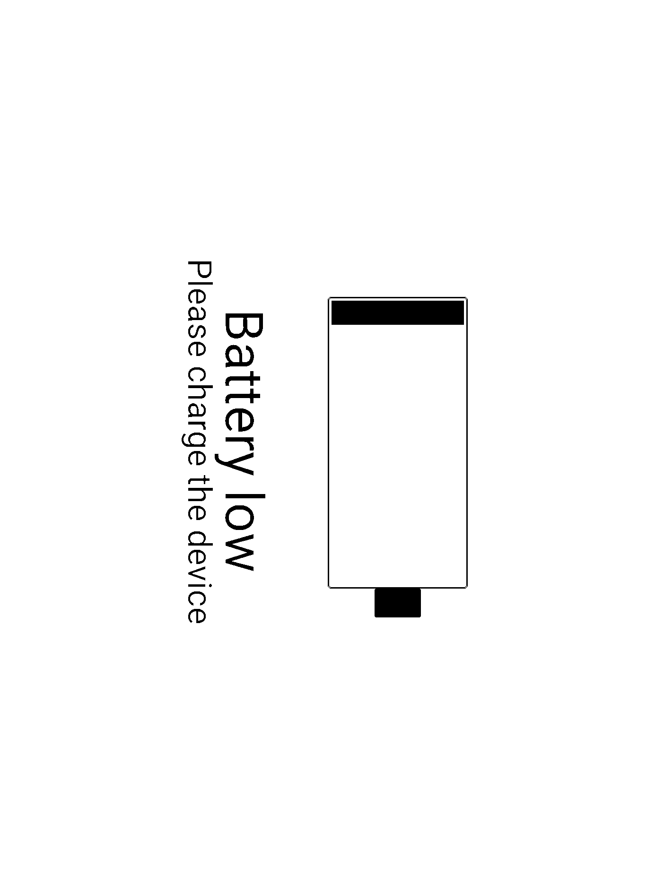
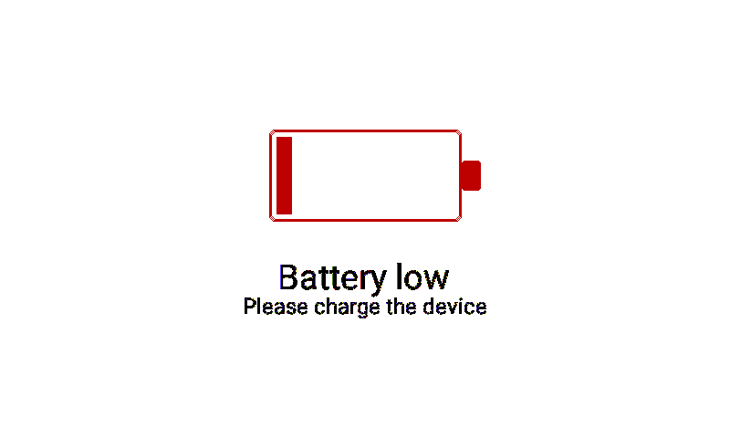

# reTerminal：最终 WASM 与低电量显示观察

本记录对应五款 reTerminal 的目录默认镜像和最终生产 WASM，SHA-256 为
`9089bd6c056e2c3752b4f04db2b7053e640aa98039c3ddc455b6a5273621f03f`，
大小 5,998,680 字节。通过真实平台 loader、worker 和 WASM 执行，使用独立空白
Flash 与默认准备的 64 MiB FAT32 卡。官方镜像没有修改；全部五份初始 Flash
分别由原始段独立装配，SHA-256 与 worker 内存基线一致。

详细输入、ROM/固件摘要、指令数、画面摘要和失败结果见
[执行收据](evidence/seeed-reterminal-20261122/receipt.json)。这不是浏览器
DOM/WebGL、实体硬件、完整 UI 或云功能验收。

## 默认固件在最终 WASM 中的结果

| 设备 | 镜像 | 实际观察 |
| --- | --- | --- |
| E1001 | SenseCraft HMI 1.1.5 | 8.02 秒、1,195,651,115 指令，`NO_FRAME`。固件报告屏幕初始化、TF 挂载成功、电量 92%，随后进入 Wi-Fi 初始化；本观察窗口内没有 UI。 |
| E1002 | SenseCraft HMI 1.1.5 | 8.02 秒、1,212,715,777 指令，`NO_FRAME`。同样完成屏幕初始化和 TF 挂载，电量 92%，进入 Wi-Fi 初始化；不算首屏通过。 |
| E1003 | SenseCraft HMI 1.1.5 | 6 秒、256,162,942 指令，一帧 1404×1872 真实画面，47,141 个非白像素；电池图标及低电量文字清楚可读。TF 挂载成功；未实现的 PMIC 与 GT911 仍报错。 |
| E1004 | SenseCraft HMI 1.1.5 | 6.04 秒、750,408,522 指令，`NO_FRAME`。屏幕初始化和 TF 挂载成功，电量 94%，进入 Wi-Fi 初始化；正常 UI 尚未验证。 |
| Sticky | 官方恢复 1.2.0 | 6.02 秒、83,989,624 指令，一帧 800×480 全白画面；显示初始化和 TF 挂载完成，但 LittleFS `/storage` 与字体文件加载失败。全白不计作有效 UI。 |

E1001/E1002/E1004 使用板级 GPIO 分压路径上的标称电池电压，固件显示的百分比
是客体算法结果，不是现实测量。上述初始化日志不足以确定 Wi-Fi 阶段的最终
阻塞原因，也不能把有限观察窗口推断为所有后续行为都失败。

E1003 的原厂低电量页面采用横向 rotation 0，板模型按原生 X 方向和实际竖向
安装映射显示，因而在竖向 framebuffer 中侧向显示。未为截图单独旋转、重画
或替换文字；IT8951 位序修复及原始依据见 [接入总记录](seeed-onboarding.md)。



## 单独的 native 低电量分支

为验证另外三块面板确实接收并显示原始固件像素，对 E1001/E1002/E1004 分别运行
六秒 native ROM 启动，并显式传入 `--adc-raw 1=0`。使用相同原厂固件段、32 MiB
Flash、8 MiB PSRAM 和准备好的 FAT32 卡。三个原始 PNG 均已目视检查，能看到
电池图标、`Battery low` 和 `Please charge the device`。

这是有说明的宿主低电量测试条件，**不能代替默认 WASM 启动结果，也不验证电池
电压转换本身**。它没有改写固件、NVS 或客体指令。native 二进制 SHA-256：
`84e13293e0524d108f4c08817fe09b0352fc525c8e134cecb29a81c7b80ef7b1`。

| 设备 | core0 指令 | core1 指令 | 画面 |
| --- | ---: | ---: | --- |
| E1001 | 36,362,639 | 198,687,959 | 800×480 单色低电量页面 |
| E1002 | 37,161,218 | 312,818,978 | 800×480 数字六色页面，红色电池图标 |
| E1004 | 41,463,675 | 124,953,569 | 1200×1600 数字六色页面，红色电池图标 |



数字调色板不模拟实物电子纸的色度、LUT、残影或温度变化。反锯齿边缘中的调色板
颜色保留客体发送的值；未对图片做美化。按键、触摸、图集切换和云连接没有在本
记录中通过行为验收。

## 复现与证据保留

```sh
ESP32SIM_ROM_DIR="$ROM_DIR" node tools/probe-seeed-runtime.mjs \
  --product seeed-reterminal-e1003 --seconds 6 \
  --output target/seeed-e1003
```

可使用调用者自己的 `--local-map "$CALLER_URL_MAP" --local-only` 重用原始下载，
普通平台的镜像 hash 和布局校验仍执行。其余板型的时间和 native 命令参数在收据
中逐项列出。native 命令的 `$FIRMWARE_DIR/<sha256>.bin` 代表按收据指定摘要命名
的原始段，不是本项目提供的镜像；这些第三方 BIN 不提交到仓库。

收据保留原始串口/日志及未净化收据的摘要，但不发布包含设备标识的原始正文。
保留的四张 PNG 不含设备标识，E1003 PNG 解码后的 RGBA 摘要与 worker 捕获值
相同。其余空白或 `NO_FRAME` 结果仍保留在收据中，不用示意图填补。
