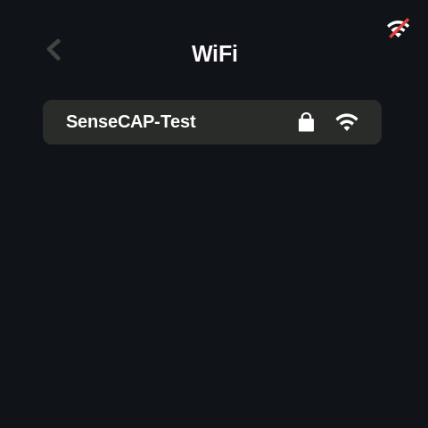

# SenseCAP Watcher W1-B and Indicator D1 runtime

The two catalog entries now select real ESP32-S3 board models. Official factory
images run through the mask ROM, bootloader and partition table. Indicator GX
renders its Wi-Fi list and a touch opens the password keyboard. Watcher renders
its welcome page with a nominal gated battery source. Both remain **partial**
and their firmware entries remain **trial**; neither was tested on hardware.

These results concern the display and the explicitly listed digital peripherals.
They do not establish working AI, camera capture, cloud identity, RP2040 sensor
processing, or complete factory operation.

## Sources and hardware boundaries

The [source receipt](research/seeed-sensecap-runtime.json) records 24 actual HTTP
downloads, final URLs, UTC timestamps, byte counts and SHA-256 hashes. Product
knowledge records carry the same receipts for their hardware facts. Relevant
fixed upstream revisions are:

| Source | Revision and purpose |
| --- | --- |
| [Watcher BSP](https://github.com/Seeed-Studio/SenseCAP-Watcher-Firmware/tree/8e37f7ccd3d836bb99f483e0f6e74e8252406644/components/sensecap-watcher) | `8e37f7ccd3d836bb99f483e0f6e74e8252406644`: GPIO, IO expander, display, touch, knob, RTC, battery and codec setup |
| [Watcher recovery images](https://github.com/Seeed-Studio/OSHW-SenseCAP-Watcher/tree/3ca69aefa8441f57d38993a39df714048633d032/Firmware) | `3ca69aefa8441f57d38993a39df714048633d032`: complete six-segment ESP32-S3 v1.1.7 recovery layout |
| [Indicator v1.0.0 source](https://github.com/Seeed-Solution/SenseCAP_Indicator_ESP32/tree/ed94f161a51b2ed1077d7eb4b887ac9f0d45fdaf) | `ed94f161a51b2ed1077d7eb4b887ac9f0d45fdaf`: GX/DX pins, FT5x06, default GX/rotation-zero configuration, native touch transform |
| [Indicator current BSP](https://github.com/Seeed-Solution/SenseCAP_Indicator_ESP32/tree/77edb8d2b9a92fc67965c1b2d4a838f0d09a1800/components/bsp) | `77edb8d2b9a92fc67965c1b2d4a838f0d09a1800`: checked against the release sources; not substituted for the release binary |
| [Espressif SPD2010 drivers](https://github.com/espressif/esp-iot-solution/tree/f721a40c032f6168844fe3bd321bc182e2593348/components/display) | `f721a40c032f6168844fe3bd321bc182e2593348`: QSPI command/page and touch-report protocol; the factory announces older component versions 1.0.1/0.0.1 |
| [PCF8563 datasheet](https://www.nxp.com/docs/en/data-sheet/PCF8563.pdf) | NXP rev. 11.1, 19 January 2026, especially register map and table 27 reset values |

### Watcher W1-B

`seeed-sensecap-watcher` is the white W1-B AI Vision SKU, with 32 MiB flash and
8 MiB PSRAM. It does not inherit the separate XiaoZhi commercial edition's
firmware compatibility.

| Function | Physical route and implemented subset |
| --- | --- |
| 412 × 412 SPD2010 LCD | QSPI CS45, SCK7, IO0=9, IO1=1, IO2=14, IO3=13; backlight8; PCA9535 output P1.1 powers the display |
| General I2C | SDA47/SCL48; PCA9535 at 7-bit `0x21`, interrupt GPIO2 |
| Touch | SPD2010 at `0x53`, SDA39/SCL38; expander P0.5 interrupt, shared display supply; BIOS/CPU/start commands, single-contact status and packed coordinates |
| Knob | Quadrature GPIO41/GPIO42; press is expander P0.3, active low, not native GPIO3; UI button ID `knob` uses `transport: board` |
| RTC | PCF8563 at `0x51` on the general bus; BCD calendar, STOP and burst-read behavior from the existing compatible calendar implementation |
| Battery measurement | GPIO3 / ADC1 channel2, 2.5 dB attenuation; PCA9535 P1.7 output must be driven high before the nominal 0.98 V pad source is enabled |
| Audio initialization | ES8311 seven-bit `0x18` and the BSP's ES7243E fallback `0x14`; bounded initialization-register write/readback only |

The LCD requires its real power gate, asserted CS, SCK/MOSI and all three extra
quad output routes. Backlight off hides the retained GRAM. Vendor pages selected
by `FF 20 10 page` cannot accidentally act as DCS sleep/display commands. The
implemented color path is RGB565, with bounded windows and SPD2010 MX/MY bits.
Analog LCD response, phase timing, arbitrary pixel formats and undocumented
vendor registers are outside the profile.

The RTC starts with its voltage-low flag set and an invalid calendar. Undefined
calendar bits use deterministic zero; no host date is injected. The shared
BM8563-compatible calendar is initialized with the PCF8563 differences: TF=0
and CLKOUT control=`0x80`. It only advances with guest cycles. Alarm/timer IRQ,
CLKOUT waveform, backup voltage and oscillator startup are unmodeled.

The battery source represents approximately 4.0 V through the official `82/20`
voltage multiplier. The tested firmware reports 4018 mV and 89%. This is a
documented simulation condition, not a battery measurement. Turning off P1.7
returns the pad to 0 V. A high input pull-up does not power the divider. Explicit
host voltage or raw ADC sources retain precedence when devices are reattached.

Codec readback does not imply functioning audio. Unwritten registers return
`FF`; no codec identity, PLL lock, microphone samples or sound is invented. The
official BSP probes ES7243 and falls back to ES7243E; this profile explicitly
selects the latter and does not assert that every W1-B PCB revision has that ADC.

The encoder's 16 UI drag divisions are a platform interaction setting. The
physical detent count per revolution remains unknown in the knowledge record.

### Indicator D1

The catalog selects `seeed-sensecap-indicator-gx`. The alias
`seeed-sensecap-indicator` also selects GX. `seeed-sensecap-indicator-dx` is a
separate board profile; its factory execution has not been verified. These
profiles do not expose both possible touch addresses at once.

| Function | Physical route and implemented subset |
| --- | --- |
| RGB LCD | 480 × 480, RGB565; data bits0…15 route to GPIO15…0; PCLK21, HSYNC16, VSYNC17, DE18 |
| Backlight | GPIO45 or its actual LEDC route and duty |
| General I2C | SDA39/SCL40; TCA9535 at `0x20` |
| GX initialization | ST7701S, nine-bit software SPI on SCK41/MOSI48, expander P0.4 CS, P0.5 reset; vendor-bank filtering and sleep/display commands |
| DX initialization | Explicit RGB profile with reset and route checks; no invented ST7701S SPI exchange |
| Touch | GX FT5x06 `0x48`, DX `0x38`; expander P0.7 reset; common single-contact register protocol |
| User button | Native GPIO38 active low; control ID `button`; GPIO0 belongs to RGB and is not exposed as a pretend BOOT key |

The S3 board derives RGB connectivity from its actual GPIO matrix signals,
including each data lane and the four control signals. It does not reuse S31
signal numbers or bypass pin routing when a framebuffer arrives. A wrong mux,
missing lane, reset or disabled backlight hides the display.

The release's `examples/terminal_demo/main/lv_port.c` computes both coordinates
as `WIDTH - raw` / `HEIGHT - raw` after the BSP's rotation-zero transform. The
profile therefore exposes the opposite native touch axes, `479 - screenX/Y`.
The original firmware's one-pixel edge discrepancy is retained. Arbitrary
rotation calibration has not been verified. The common FT device's short-event
retention is a digital sampling convenience, not an exact touch scan cadence.

The tested runtime has 8 MiB PSRAM. The release source enables octal PSRAM but
does not prove the precise SKU's physical capacity; that fact remains unknown.
D1 does not inherit D1S/D1Pro air-quality sensors or D1L/D1Pro LoRa. RP2040,
sensor data and SD transport remain absent.

## Why chip-select continuity was necessary

The real Watcher firmware sends a four-byte QSPI command header and its
parameters as separate GP-SPI transfers while holding CS active. For example:

```text
02 00 FF 00   (CS held)
20 10 00     (CS released)
32 00 2C 00  (CS held)
... RGB565 payload chunks ...
```

`SpiPins.keep_cs` carries the existing GP-SPI MISC `CS_KEEP_ACTIVE` bit30 into
the already-existing physical route snapshot. ESP-IDF v5.2.1
[`spi_reg.h`](https://github.com/espressif/esp-idf/blob/v5.2.1/components/soc/esp32s3/include/soc/spi_reg.h)
and [`spi_ll.h`](https://github.com/espressif/esp-idf/blob/v5.2.1/components/hal/esp32s3/include/hal/spi_ll.h)
are retained in the source receipt. No new per-tick route query or `BoardModel`
method is added. `SpiPins` still occupies 32 bytes; the new boolean fits padding.
Legacy complete struct literals explicitly keep the old `false` behavior.

The Watcher parser now consumes a continuous CS stream. It accepts split
headers, preserves pixel data that happens to begin `02 00 2C 00`, and discards
partial headers when CS actually ends. Unit and MMIO tests cover these cases.
The user's fork had no open PRs, and none of nine inspected upstream PR file
lists touched the shared transport files; the linked API review is recorded.

## Factory execution evidence

Captures are direct framebuffer output. Their receipt records the original PNG
hash and a lossless, pixel-identical compressed copy. The virtual SSID shown is
a test fixture. No passwords were entered and no station connection was made.

| Case | Observed result |
| --- | --- |
| Indicator v1.0.0, GX, 8 s | 499 RGB frames and 76 nine-bit initialization commands; Wi-Fi list contains the supplied virtual AP |
| Same Indicator image, touch `(200,136)` down at5.0 s and up at5.2 s | Guest reads FT5x06 reports and replaces the list with its actual password keyboard |
| Watcher v1.1.7, nominal gated battery, 8 s | 3,050,448 RGB565 pixels / 18 frames; real “Connect to App / Skip” welcome page, 4018 mV / 89% in UART |
| Watcher before nominal battery attachment | With 0 V at GPIO3, RTC initialization succeeds and the guest draws the red low-battery icon; no reset loop |
| Watcher touch and quadrature attempts | Touch at3.0/3.2 s and one clockwise quadrature sequence at3.0 s reach the guest buses/interrupts, but the final welcome frame remains identical. Repeating at12 s also leaves it unchanged. Application navigation is **not verified**. |




Watcher negative findings are retained: the public recovery set lacks its
device-specific factory identity NVS, SenseCraft reports a device-info failure,
SPIFFS mount returns `-10025`, and HX6538 SPI requests time out. Its storage
partition starts at `0x1a10000`; a diagnostic SPI_MEM trace showed reads at
`0xa100fc`, so high-address flash handling remains an investigation lead, not
a proven fix. The model does not manufacture an identity or AI response.

The CLI prints the board report before its final PWM refresh; consequently its
pre-capture `visible=false` can precede a correctly lit PNG. Framebuffer capture
refreshes the real LEDC duty. The Watcher rejected-transfer counter also counts
SPI traffic directed to the unmodeled HX6538 endpoint, not only malformed LCD
traffic.

## Reproduction

Obtain the ROM using the existing repository instructions. Resolve the catalog
firmware source and assemble the exact Watcher six-segment manifest into a
32 MiB erased flash image. Do not fill its missing identity partition. Indicator
uses the complete official v1.0.0 merged image, hash
`749c9b77222405e2b2ffc1a08f3d51a0752e762e10b6bba6c426f5440d638cf2`.

```sh
target/release/esp32sim --chip s3 --board seeed-sensecap-watcher \
  --flash-mb 32 --psram-mb 8 --boot rom --rom ROM.elf \
  --flash-image watcher-32MiB.bin --max-seconds 8 --console uart0 \
  --tft-png watcher.png --no-dump

target/release/esp32sim --chip s3 --board seeed-sensecap-indicator-gx \
  --flash-mb 8 --psram-mb 8 --boot rom --rom ROM.elf \
  --flash-image indicator-v1.0.0.bin --max-seconds 8 --console uart0 \
  --wifi ssid=SenseCAP-Test,psk=verification-only --script touch.txt \
  --tft-png indicator.png --no-dump
```

`touch.txt`:

```text
5.0 touch 200 136 1
5.2 touch 200 136 0
```

For the low-battery condition, supply an explicit `0 adc 3 0` script. The guest
can still read its other physical inputs; the host override does not change
the gate model itself.

## Checks and limits

- `cargo test -p esp32s3 --lib seeed_`: 18 passed, including nine tests of these two boards.
- `cargo test -p esp32s3 --test pin_transport`: six passed; the external firmware fixture test remains explicitly ignored.
- Native CLI built successfully with all chip crates. Final functional debugging builds used release optimization with LTO disabled; their elapsed times are not performance evidence.
- Strict S3 Clippy passed with the pre-existing UC8179/T133A01/reTerminal missing-else formatting fixes applied temporarily in the isolated checkout. Those unrelated formatting edits were restored; the integration tree owns the complete gate.
- Catalog schema, knowledge source references, and 107 retained Seeed HTTP originals pass validation. Config, human input and framebuffer lifecycle JavaScript tests pass.
- The isolated runtime worker test lacked generated WASM/demo artifacts; the complete worker/browser and median-CPU comparisons belong to the final integration gate. No claim is made that these local functional runs replace that gate.

Raw UART/debug logs contain firmware build paths and generated device identity
fields and are not published. The curated receipt retains numeric observations,
commands, input-image hashes, source hashes, and pixel-identical captures.
