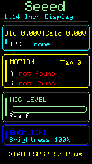
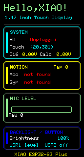
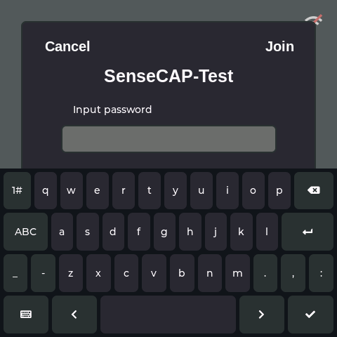

# Seeed display devices: actual WASM execution and input checks

The 2026-11-22 run exercised **seven catalog defaults through the real platform
loader, `runtime.js`, browser worker and WASM module under Node**. All seven
booted through their chip's ROM with unmodified official image bytes and no
function stubs. Three XIAO IPS dashboards and the Indicator GX passed the
listed display/input checks. Watcher and TRMNL S3 displayed their original UI
but did not complete the tested navigation/button action. C3 remained blocked.

This is a worker/WASM result, separate from native execution and browser
DOM/WebGL interaction. It does not certify full device compatibility, physical
hardware, microphone/audio, camera, cloud services, browser CORS or networking.
Catalog `partial`/`trial`, `simulationVerified:false` and
`hardwareValidated:false` remain appropriate.

## Exact executable and firmware identity

- WASM: **5,998,680 bytes**, SHA256
  `9089bd6c056e2c3752b4f04db2b7053e640aa98039c3ddc455b6a5273621f03f`.
- Unpublished local harness checkpoint: `6aa093c41c912bd01d0879d952f5ca5ee9f957d6`.
  The receipt's harness SHA256 identifies the measured file independently of
  the consolidated publication commit; see the [integration provenance note](evidence/seeed-integration-20261122/README.md).
- The [execution receipt](evidence/seeed-wasm-20261122/receipt.json) records the
  worker/harness SHA256, ROM SHA256, each unchanged official artifact and ZIP
  member SHA256, complete initial Flash SHA256, input receipts, guest times,
  instruction counts and raw framebuffer hashes.
- The three IPS loaders extracted each exact flash segment from its pinned
  official ZIP, checking both archive and member digests. Watcher used its
  official six-segment restore layout. Indicator and both TRMNL devices used
  their complete published images. No application-only image was substituted.
- Downloaded official bytes were supplied through the harness's local URL map.
  That map is an investigator fixture and is not committed. The platform still
  performed its ordinary pinned-hash and layout checks. Fresh remote fetching
  and browser cross-origin permissions were not tested by this run.

The full initial Flash hashes include erased padding to the board's declared
capacity, so they differ from the original shorter merged-image hash. Both
identities are retained in the receipt. Isolated in-memory storage began
pristine for every run; no existing user's saved Flash or SD card was cleared.

## Observed outcomes

| Catalog device | Official image | Actual result |
|---|---|---|
| XIAO 0.96-inch IPS | Pinned factory ZIP; boot-ready string 1.13.1 | Dashboard; brightness key reduces mean RGB from 22.4653 to 16.6038; backlight key makes every pixel black and a second press restores output. |
| XIAO 1.14-inch IPS | Factory 1.2.4 | Third key changes the header to **Seeed**, changing 592 framebuffer pixels; brightness, complete blanking and restoration pass. |
| XIAO 1.47-inch IPS touch | Factory 7.14 | Guest reports touch **(20,301)** and release. Held contact changes 119 pixels in the touch row; release restores the initial frame exactly. Brightness, complete blanking and restoration pass. |
| SenseCAP Indicator D1 GX | Published factory 1.0.0 | Real 480×480 WiFi list; touch **(200,136)** opens the original password keyboard and changes 205,305 pixels. |
| SenseCAP Watcher W1-B | Factory 1.1.7 | Real 412×412 welcome page with 38,136 nonblack pixels. Skip touch, one encoder step and knob press all leave the frame byte-identical; navigation remains unverified. |
| TRMNL 7.5-inch OG DIY Kit / S3 | TRMNL project 1.8.19 | Real 800×480 provisioning page with 8,639 black pixels. D4 short press leaves the frame unchanged; its application workflow remains unverified. |
| XIAO 7.5-inch ePaper / C3 | TRMNL project 1.8.19 | Application starts, then **RTCWDT_RTC_RESET at 8.950 guest seconds**. At 10 seconds all 384,000 pixels are white. No usable page or interaction is claimed. |

The 0.96-inch factory executable emits **both** a 1.13.3 introductory banner
and a 1.13.1 boot-ready line. The catalog keeps the latter and the exact pinned
binary identity; the receipt preserves this inconsistency. Indicator's file
was published as 1.0.0 but its embedded app descriptor reports
`terminal_demo-v1.0.0-11-g82ddd9`. A release label is not proof that the binary
was built from the release tag's exact source revision.

The brightness ratio is measured against the immediately applicable full
brightness frame. For 1.14-inch, this is the frame after changing the header;
otherwise the text change would distort the comparison. Framebuffer means
are approximately 73% of that baseline at the guest's nominal 75% setting.
No physical panel luminance calibration is implied.

### Actual frame examples

These are lossless PNG encodings of the worker's native RGBA framebuffer.
Decoded PNG bytes were checked against the original RGBA SHA256; no labels,
mock UI or replacement content were drawn into the images.








## Retained negative results

Watcher still reports a missing factory identity namespace, SPIFFS mount
failure `-10025` and HX6538 request timeouts. Its nominal gated ADC produces
89% battery status; this does not remove those independent failures. Its
WASM input receipts show queued events, while the visible page does not
change. The earlier [native bus checks](seeed-sensecap-runtime.md) cover the
touch/encoder transport; they do not make this navigation test pass.

TRMNL S3's D4 acknowledgement also proves only queue delivery. C3's white
framebuffer is retained as a failure even though the generic probe exits
successfully after observing ten guest seconds. The curated result explicitly
marks it blocked by the existing C3 light-sleep/watchdog gap. The earlier
native reset at approximately 8.749 seconds and this WASM reset at 8.950 seconds
are separate observations; neither value replaces the other.

No additional fake user keys were sent to C3. The catalog exposes none for
this product. Its hardware BOOT and whole-board reset are not interchangeable
with application buttons.

## Reproduce

Build the repository's WASM and fetch the official ROMs first. Then use the
unchanged default firmware and one of the retained input plans:

```sh
ESP32SIM_ROM_DIR=target/roms node tools/probe-seeed-runtime.mjs \
  --product seeed-xiao-ips-147 --seconds 6 \
  --inputs docs/platform/evidence/seeed-wasm-20261122/inputs/seeed-xiao-ips-147.json \
  --output target/seeed-wasm

ESP32SIM_ROM_DIR=target/roms node tools/probe-seeed-runtime.mjs \
  --product seeed-sensecap-indicator --seconds 8 \
  --network-json docs/platform/evidence/seeed-wasm-20261122/inputs/indicator-network.json \
  --inputs docs/platform/evidence/seeed-wasm-20261122/inputs/seeed-sensecap-indicator.json \
  --output target/seeed-wasm
```

All seven input files and requested startup times are listed in the receipt.
Buttons and encoders use the implemented `input({type,id,...})` API; touch uses
native framebuffer coordinates. Guest-time holds, repeated contact reports
and the optional held-frame capture are explicit in each plan. The Indicator
fixture only announces a synthetic `SenseCAP-Test` router, with outbound
networking and automatic provisioning disabled. No password was entered and
no join attempt was made.

`--local-map <caller-provided-json> --local-only` may reuse previously
downloaded official bytes without allowing unmapped remote downloads. The
same hashes remain mandatory. Reproductions retain raw serial/frame files in
their chosen output directory; inspect them before publication.

## Evidence retention and privacy

The curated receipt covers **7 ROM boots, 16 input actions and 24 captured
frames**. It preserves each raw receipt and serial SHA256, all framebuffer
SHA256 values, explicit failures and the exact successful assertions. Raw
serial and receipt bodies are not committed because they contain device
identifiers. Selected identifier-free guest markers are retained.

TRMNL S3's original provisioning frame includes a generated device SSID and
QR code, so that PNG is omitted; its complete original pixel hash and numeric
statistics remain. The entirely white C3 image is represented by its hash and
statistics. Other retained PNGs were visually reviewed for identifiers. These
omissions do not alter any measured pixel value or turn a failed action into
a passed one.
