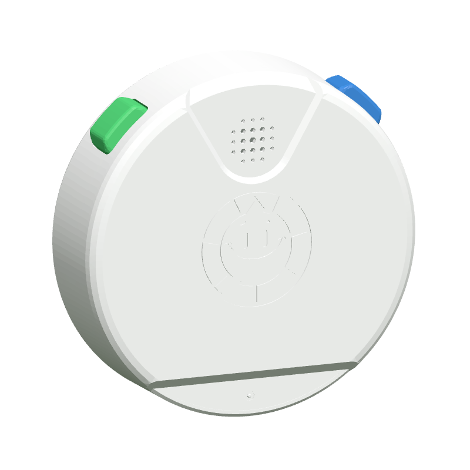
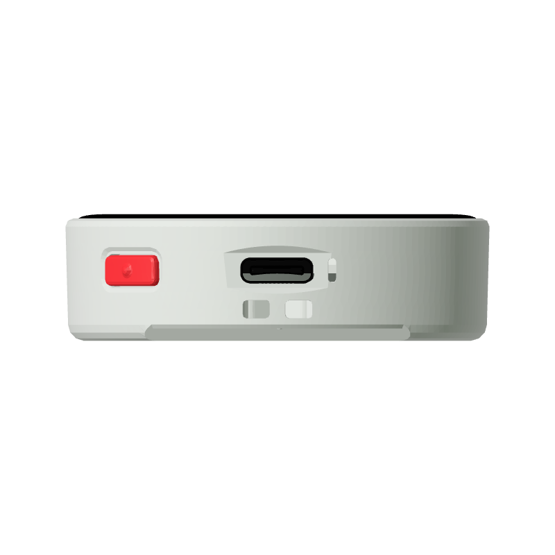
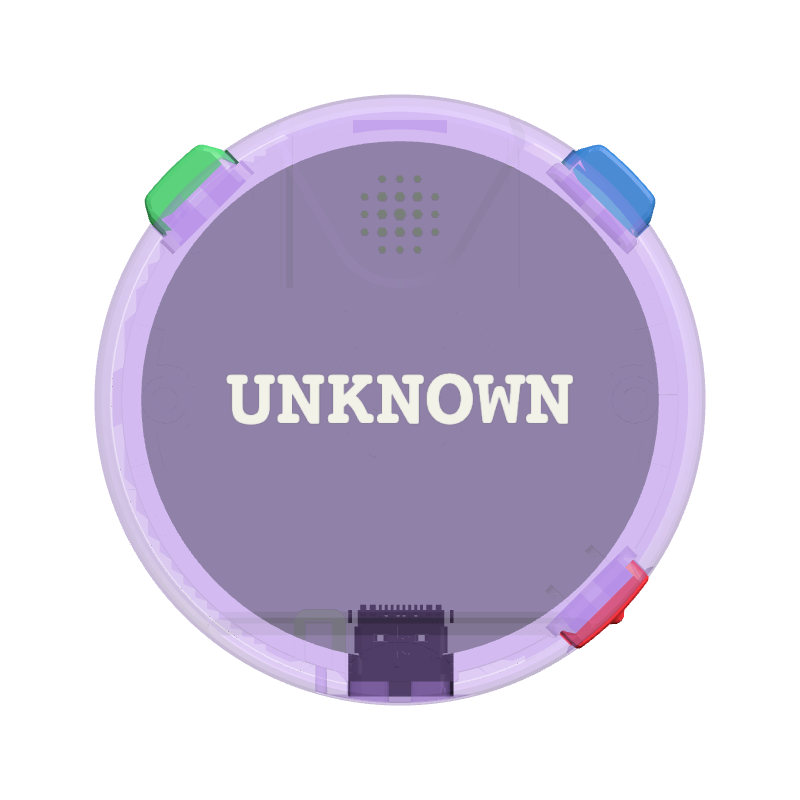

# TriviaPOD：StopWatch 下的外观衍生预览

在左侧选择 **M5Stack StopWatch**，打开 3D 区域的 **衍生模型**，选择 **TriviaPOD TP-01-A · 白色**。查看外观不会改变设备配置；加载或运行固件时自动切回 StopWatch 本体，暂停后可再次选择预览。TriviaPOD 不单独占用左侧设备列表，但完整产品和知识记录仍保留。

TriviaPOD 有独立的官方模型，不能只给 StopWatch 换贴图。[官方比较表](https://docs.m5stack.com/en/core/TriviaPOD)确认其 Flash 为 32 MB，取消 Grove、后部扩展总线与背部磁吸。官网[旋转展示的 glTF](https://triviapod.com/assets/models/TriviaPod3D.gltf.js)包含白色封闭后盖、浮雕、扬声器孔、三颗按键、黑色屏幕和独立 USB-C。这里保留全部 6 组源网格、81,532 个三角形，未拼入 StopWatch 的连接器或后部结构。

## 来源与变换

- 原网站文件 SHA-256：`fd222026f75612a56fba1eaa3dfe81a9c61c79133f0026c54effaa4ed8f889b3`。只解析 `window.GLTF_B64` 的字符串数据，不执行下载的 JavaScript。
- 解码 glTF SHA-256：`d2870244aa86264b14f44932bb47d78a7f0b0b5ecf5c3e2844b28a7dc672d07a`，原字节保存在 [source.gltf.gz](../../web/platform/assets/m5stack-triviapod/source.gltf.gz)，gzip 时间固定为 0。
- 先应用原始节点变换（包括独立 USB-C），再整体转为 `(-Y, -Z, X - 7.75)`。保留源顶点、三角形及法线；白色恒等顶点色和没有贴图的 UV 不进入渲染二进制。没有重新缩放零件或猜测装配偏移。
- **单位仅为展示推定。** glTF 通常以米为单位，但本资产外径数值约为 51.947，官网展示器按包围盒重新归一化。平台保留源数值、按毫米显示，使其与 StopWatch 外形量级一致。官方 TriviaPOD 实物尺寸和重量仍是 WIP，不能把这些坐标称为已核验的产品尺寸或生产 CAD。
- 原材质定义保留在每组零件的 `sourceMaterial`。白壳显示色取 `#d5d5d5`，防止平台强光淹没浮雕；这不是测得的塑料反射率。黑色屏幕采用不透光的标准材质，不添加游戏截图或假帧缓冲。清漆和透射没有光学还原。
- 未找到板级 CAD、布局或内部装配资料。`pcb-main` 是估算的 44×44×1 mm 中性空白占位，厚度、板形、位置、颜色均未核实。透明模式从背面可见 `UNKNOWN`；不计入内部精度验收。

来源时间、URL、字节数与哈希在 [source-receipts.json](../../web/platform/assets/m5stack-triviapod/source-receipts.json)，硬件及固件调查在[知识记录](../../web/platform/knowledge/m5stack-triviapod.json)。官网模型没有查到独立开放许可；官方照片保留 M5Stack 权利。两者都不套用项目或 M5_Hardware 的 MIT 许可，见 [SOURCE-RIGHTS.txt](../../web/platform/assets/m5stack-triviapod/SOURCE-RIGHTS.txt)。网页只加载仓库内的渲染资产，不执行来源脚本或调用第三方模型 CDN。

## 复现与验证

这是官网 glTF 的专用导入器，不走 STL/STEP 的通用重建计划。安装 NumPy 后，从仓库根目录离线重建：

```sh
python tools/build-triviapod-model.py --output /tmp/triviapod-rebuilt
cmp web/platform/assets/m5stack-triviapod/model.json /tmp/triviapod-rebuilt/model.json
cmp web/platform/assets/m5stack-triviapod/geometry.bin /tmp/triviapod-rebuilt/geometry.bin
```

两份输出逐字节一致。模型对照页是 [triviapod-model-review.html](../../tools/fixtures/triviapod-model-review.html)，通过仓库静态服务器打开即可。`review.show('front'|'backOblique'|'left'|'right'|'bottom')` 切换方向；`review.appearance({shell:{color:'#9d74cf',opacity:.24,finish:'plastic'}})` 查看透明壳。对照页使用固定的展示光源，外壳经过与正式页面相同的默认 plastic 外观处理。

已与保留的官方照片 05–08 核对后壳结构、按键方向和 USB-C 开口，并检查白色、金色、透明紫色。照片机位和光照没有标定，实物尺寸未知，所以这只是可见结构和方向对照，不宣称通过尺寸 1:1 或轮廓重合率验收。官网网格的分面与浅浮雕仍可见，没有人为补猜隐藏细节。





浏览器实测覆盖工作台、独立 mini 和 iframe：预览时场景仍为 StopWatch，加载/启动后自动回本体并禁用衍生选择；官方 StopWatch V0.5 真正启动，输出 468×466 帧缓冲和引导页；暂停后可恢复 TriviaPOD 预览。完整截图、最终资产哈希和检查结果见 [verification.json](evidence/triviapod-20261105/verification.json)。全部 326 项平台测试、目录/知识校验，以及当前稳定 Rust 的本地 CI 命令通过。

TriviaPOD 条目保持 `runtime.board: null`、`status: unavailable`，没有默认固件或继承的 GPIO、触摸控制器、附件接口。官方软件由 Etermax 专有开发，当前只确认机内 Wi-Fi 更新入口，未找到公开出厂镜像或该 SKU 的官方 UIFlow/小智映射。本次没有运行 TriviaPOD 固件，也没有实机测试。
